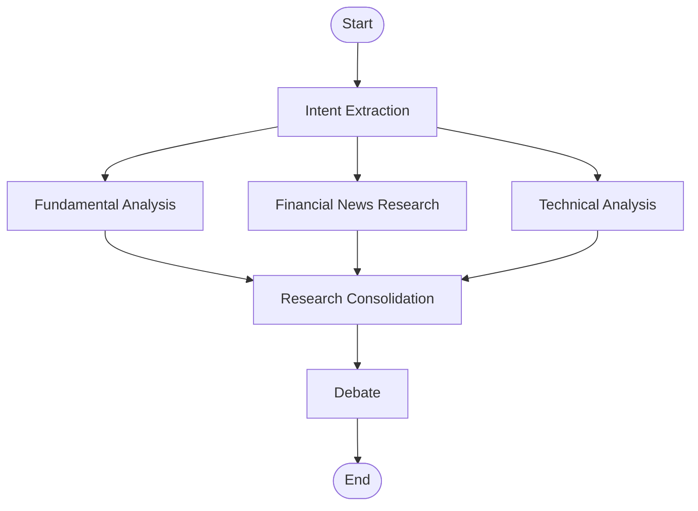

# Value Investment Agent (Neuro-Symbolic Valuation Engine)

The **Value Investment Agent** is a Neuro-Symbolic Valuation Engine that decouples semantic reasoning (Probabilistic) from financial calculations (Deterministic). It employs a multi-agent system to perform comprehensive fundamental analysis, extract financial parameters, and calculate intrinsic value using precise financial models.

## 🚀 Overview

Traditional LLM-based financial tools often hallucinate numbers or struggle with complex arithmetic. This project solves that by separating the "thinking" from the "math":
*   **Agents (Neuro)**: Understand user intent, research companies, analyze news, and extract specific valuation parameters from unstructured data (10-Ks, 10-Qs).
*   **Engine (Symbolic)**: A deterministic calculation layer that accepts validated parameters and executes financial models (e.g., DCF, DDM) with mathematical precision.

## 🧠 Neuro-Symbolic Architecture

The system is built on two core pillars:

### 1. Agents & Workflow (The "Graph")

The probabilistic side of the system is a **LangGraph** workflow that orchestrates specialized agents to gather, analyze, and validate data.



#### Agent Hierarchy

*   **`intent_extraction`** (Subgraph): Identifies the user's intent, resolves ambiguity, and locks in the target company.
    *   `extraction`: Extracts company name, ticker, and analysis goals from the initial query.
    *   `searching`: Performs web or Yahoo Finance searches to find valid stock tickers if missing.
    *   `deciding`: Determines if the collected information is sufficient or if user clarification is needed.
    *   `clarifying`: Handles Human-in-the-Loop (HITL) interactions to resolve ambiguity with the user.
*   **`fundamental_analysis`** (Subgraph): Fetches financial data and computes intrinsic valuation.
    *   `financial_health`: Fetches XBRL data from SEC EDGAR and generates a baseline health report.
    *   `model_selection`: Selects the appropriate valuation model (e.g., SaaS, Bank) based on the company's industry profile.
    *   `calculation`: Bridges to the deterministic calculation engine to execute the selected financial model.
*   **`financial_news_research`** (Subgraph): Gathers and analyzes market sentiment in parallel.
    *   `search_node`: Finds relevant news articles across multiple timeframes.
    *   `selector_node`: Filters articles for relevance using an LLM.
    *   `fetch_node`: Retrieves full text content for selected articles in parallel.
    *   `analyst_node`: Performs deep analysis on each article (Sentiment + Key Facts).
    *   `aggregator_node`: Synthesizes all analyses into a final sentiment score and summary.
*   **`technical_analysis`** (Subgraph): Extracts technical indicators and price action features.
    *   `data_fetch`: Retrieves historical price and volume data.
    *   `fracdiff_compute`: Computes fractional differentiation and other quantitative momentum features.
    *   `semantic_translate`: Translates raw technical data into an LLM-readable narrative.
*   **`consolidate_research`** (Node): A synchronization point that aggregates output from Fundamental, News, and Technical agents into a unified context.
*   **`debate`** (Subgraph): Challenges assumptions through structured, multi-round agent discourse.
    *   `debate_aggregator`: Prepares topics and context for debate based on consolidated research.
    *   `fact_extractor`: Pulls out core, undisputed facts to ground the debate.
    *   `Round 1, 2, 3`: Iterative discourse involving a `bull` (arguing for), `bear` (arguing against), and a `moderator` (evaluating arguments).
    *   `verdict`: The final synthesized conclusion and investment recommendation.

### 2. Calculation Engine (The "Math")

The deterministic side is handled by the **`CalculationGraph`** (`src/agents/fundamental/subdomains/core_valuation/domain/engine/core.py`).

*   **Dependency Inference**: It automatically builds a Directed Acyclic Graph (DAG) by inspecting function signatures.
*   **Topological Execution**: Uses NetworkX to determine the correct order of operations, ensuring variable dependencies (e.g., `revenue` -> `ebit` -> `fcff`) are resolved before calculation.
*   **Traceability**: Every number is traceable back to its source (XBRL tag, formula, or user assumption).

## ✨ Key Features

### 📊 Valuation Models
Currently supported models:
*   **DCF Standard**: Standard Discounted Cash Flow.
*   **DCF Growth**: Discounted Cash Flow assuming a high-growth phase followed by stable growth.
*   **EV Multiple**: Enterprise Value Multiple valuation.
*   **EVA**: Economic Value Added model.
*   **REIT FFO**: Funds From Operations valuation tailored for Real Estate Investment Trusts.
*   **Residual Income**: Residual Income valuation model.
*   **SaaS FCFF**: Free Cash Flow to Firm model tailored for Software-as-a-Service companies.
*   **Bank DDM**: Dividend Discount Model for valuing financial institutions.

## 🏗️ Architecture

*   **Frontend**: [Next.js 16](https://nextjs.org/), React 19, TypeScript.
*   **Backend**: Python, [FastAPI](https://fastapi.tiangolo.com/), [LangGraph](https://langchain-ai.github.io/langgraph/). Organized by feature ownership, with internal layers where they clarify dependencies between finance logic and infrastructure.
*   **Database**: PostgreSQL (for state persistence and checkpointing).
*   **Infrastructure**: Docker Compose.

## 🛠️ Getting Started

### Prerequisites
*   [Docker](https://www.docker.com/) and [Docker Compose](https://docs.docker.com/compose/)
*   An [OpenRouter](https://openrouter.ai/) API key for the provider settings page

### 1. Environment Setup
Create a local `.env` from the checked-in template:

```bash
cp .env.example .env
```

The template gives the backend and each internal service matching local
authentication tokens. In particular, `INFERENCE_SERVICE_TOKEN` is passed to
both inference containers and mapped to the backend's `MODEL_INFERENCE_TOKEN`.
Keep those values identical when overriding them. Replace the local
`LITELLM_MASTER_KEY` value with a private random value. OpenRouter user keys are
added and tested in the app's LLM settings; do not put them in
`LITELLM_MASTER_KEY`.

`SEARCH_SERVICE_TOKEN` must match between the backend and Search Service. The
Compose default is for local development only; deployments must inject a unique
secret. Generate a stable Search key-encryption value from `search-service/`:

```bash
uv run python -c 'from cryptography.fernet import Fernet; print(Fernet.generate_key().decode())'
```

Add the command's output to the untracked root `.env` as
`SEARCH_PROVIDER_ENCRYPTION_KEY=<generated-value>`. Back it up separately, and
do not rotate or discard it while encrypted provider keys remain in the
database. Search readiness stays unhealthy until PostgreSQL and this encryption
key are configured.

The `STAGING_*` entries are optional and are used only by
`scripts/refactor_staging_smoke.sh`. They should point to disposable test
credentials and staging-only OpenRouter keys, not a personal account.

The default local Compose setup loads `docker-compose.override.yml`. It gives
the backend and provider service the same `local-development-only-token` when
`LLM_PROVIDER_SERVICE_TOKEN` is unset. This value is for local development
only. Search uses the same development-only pattern for `SEARCH_SERVICE_TOKEN`.

### 2. Run with Docker (Recommended)
Build and start the entire stack:

```bash
docker compose --profile llm-gateway up --build
```

Access the application:
*   **Frontend**: [http://localhost:3000](http://localhost:3000)
*   **Backend API**: [http://localhost:8000](http://localhost:8000)
*   **API Documentation**: [http://localhost:8000/docs](http://localhost:8000/docs)
*   **LLM settings**: [http://localhost:3000/settings/llm](http://localhost:3000/settings/llm)

Open the LLM settings page, add one or more OpenRouter keys, and select a
free model. The backend sends all application requests through the internal
`openrouter-default` LiteLLM route.

For production, provide `LLM_PROVIDER_SERVICE_TOKEN` through your deployment
secret manager and use `docker-compose.production.yml`. The production overlay
sets `APP_ENV=production` and fails Compose configuration when the token is
missing. Pass both Compose files explicitly so the local development override
is not loaded:

```bash
docker compose \
  -f docker-compose.yml \
  -f docker-compose.production.yml \
  --profile llm-gateway up -d --build
```

### 3. Manual Development (Optional)

#### Backend (`finance-agent-core`)
The backend uses `uv` for dependency management.

```bash
cd finance-agent-core
uv venv
source .venv/bin/activate
uv sync
uv run start
```
*   Run tests: `uv run pytest`

#### Frontend (`frontend`)
The frontend uses `npm`.

```bash
cd frontend
npm install
npm run dev
```

## 🧭 Development Guidelines
The two canonical engineering guides are:

*   [`docs/README.md`](docs/README.md) (documentation index)
*   [`docs/backend-guideline.md`](docs/backend-guideline.md)
*   [`docs/frontend-guideline.md`](docs/frontend-guideline.md)
*   [`docs/frontend-ui-guideline.md`](docs/frontend-ui-guideline.md)

Agent graph and dependency rules are defined in the [Agent Architecture Standard](.agents/skills/architecture-standard-enforcer/references/cross-agent-architecture-standard.md).

Cross-stack contract sync:

*   Run `bash scripts/generate-contracts.sh` after backend API contract changes.
*   Commit both generated files:
    *   `contracts/openapi.json`
    *   `frontend/src/types/generated/api-contract.ts`

Service contracts, design decisions, research reports, and runbooks are indexed in [`docs/README.md`](docs/README.md). They add detail for their own topic and do not define a second general coding standard.

## 🤝 Contributing
Contributions are welcome! Please follow the coding standards outlined in the project.
1.  Fork the repository.
2.  Create a feature branch.
3.  Commit your changes.
4.  Open a Pull Request.
