# #477 正式頁面證據

本檔保留 c46d9fba191c3b793749198ca444b5ef96f3396d 的原始實頁證據，並追加75c75c29745a6f802eb2000ac31bb0a52931107e的Header修正後畫面。截圖來自正式 workspace 與本 issue 隔離服務，沒有 mock API。超過 repository 單檔限制的 PNG 轉為無損 WebP，逐像素核對相等，尺寸不變。原始 PNG 保存在隔離 diagnostics，未刪除。原始320px截圖寬327px是#480的歷史失敗證據；下列fixed圖為修正後320px。

## Header 修正後正式畫面

Capture commit：`75c75c29745a6f802eb2000ac31bb0a52931107e`。Canonical layout test exit0，light/dark×320/390/768/1440、窄pane、reduced motion與完整正反向focus cycle通過。原生Chrome重新載入同一runtime後觀察Zoom:200%，公司與估值數字可讀；最後已還原100%。

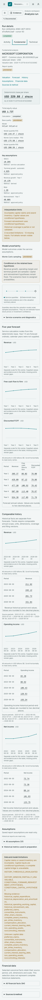

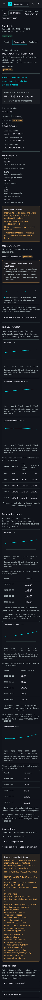

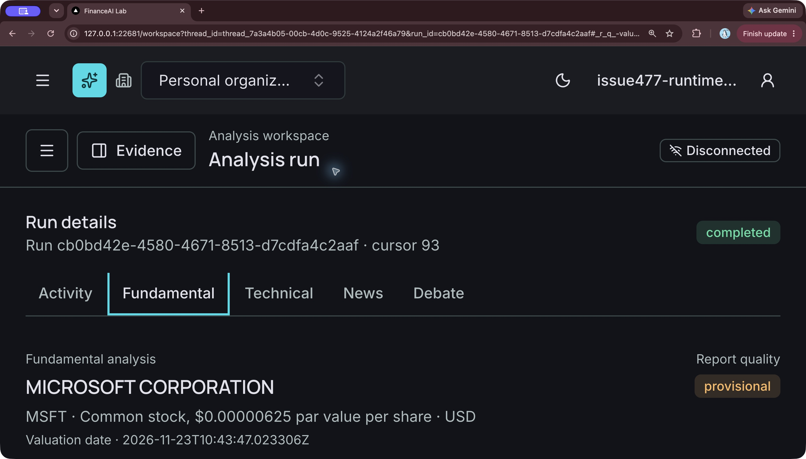

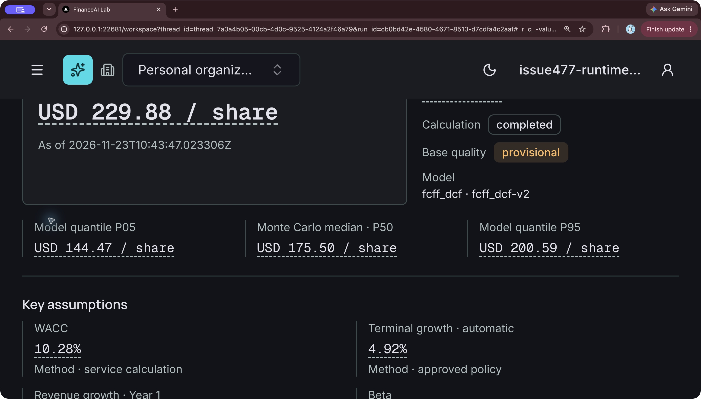

| 檔案 | SHA-256 |
| --- | --- |
| layout-light-320-fixed.webp | `8170fc74b5b447027d0b6dc875efd84f972533232cf82e9bcc96cbf13bf940ce` |
| layout-dark-320-fixed.webp | `ade3d41ae5ef953e1454efc7fb32c008af69f9dc6eeb7d6ba3fd879b3481216b` |
| zoom200-75c75c29.webp | `b7afe97ade021dd96b3e42619c5b9400b9eac5f5fc4b4d375ce1f4406f327845` |
| zoom200-values-75c75c29.webp | `64981513d1e25e9653957dac29d2a755adf30fa28ef1428eb69e4b9456b291ed` |

## 早期正式畫面

### 1440px light 連續章節


### 1440px dark 連續章節


### 320px light，Header 溢出尚未修復

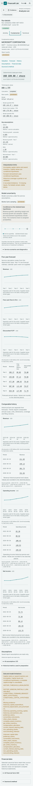

### 390px dark

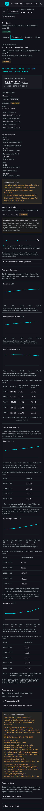

### 獨立窄 report pane


### Sheet keyboard focus cycle

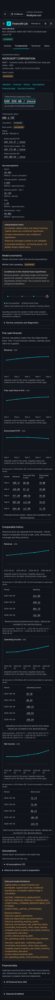

### 2.5%重算完成，新報告與來源

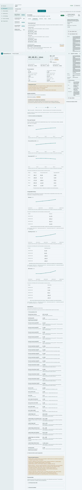

### 5%真實服務拒絕，previous與draft保留

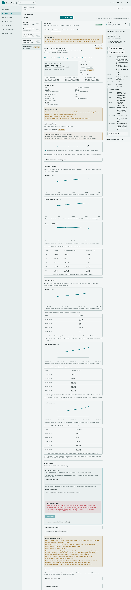

### Touch查證

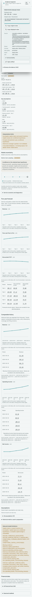

### 原生Chrome 200%公司資料重排

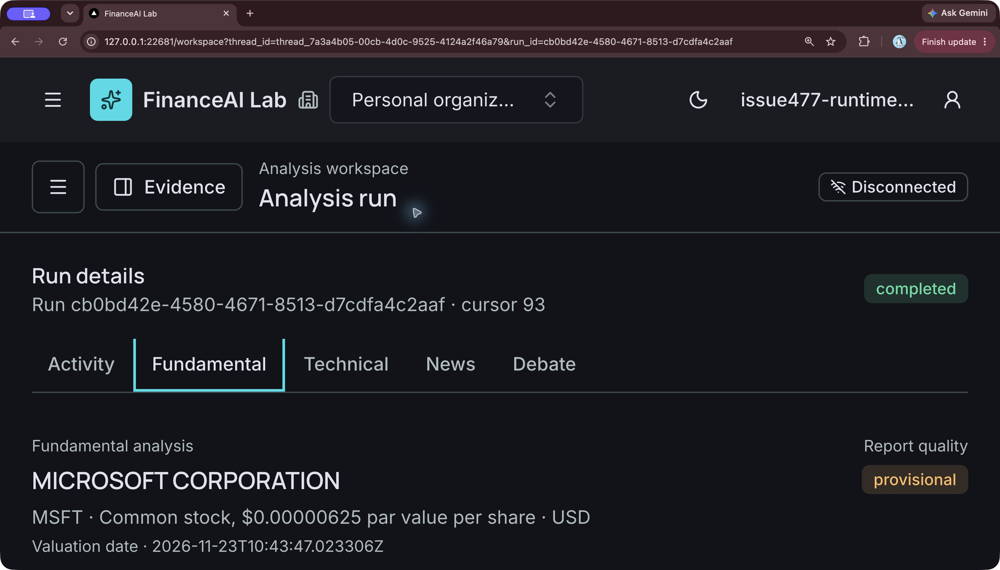

### 原生Chrome 200%數值可讀

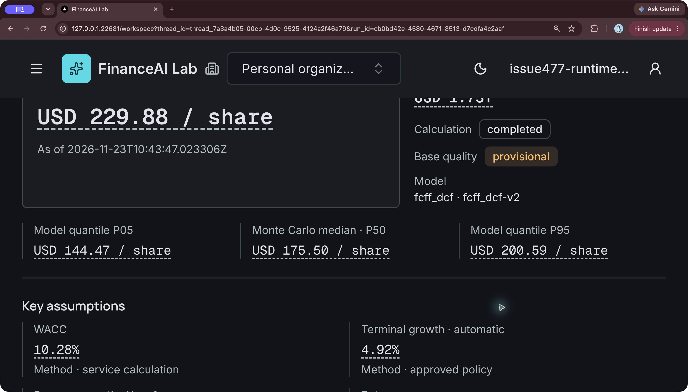

## 已交付截圖 SHA-256

| 檔案 | SHA-256 |
| --- | --- |
| layout-light-1440.webp | `cd52b73687b23e20c2416f6de962c4f23bdd04bbed342de31b8279c0a6272487` |
| layout-dark-1440.webp | `70f0d951db63a43ce36a1aab86004f039cdab6deb08a8dc96e450c440e3c1cb0` |
| layout-light-320.webp | `8a659cc7ee323dd7e328a796268a21967e1e4afe3e785c0a96b4bf87d56ce870` |
| layout-dark-390.webp | `4385736af1452fdf7654cad930ca56bd00d67ad2f10900a0d52eefe29450b57d` |
| layout-independent-narrow-pane.webp | `fb0b56fcf8fcb863bc5731f9a650900a093d0f2c79702beefb45e30cc7332cc2` |
| sheet-keyboard-focus-cycle.webp | `6b52b7c96b3dcf4c46aae654a697ee32c6ce88c7800506b2ce9f95cf4d60b18b` |
| revision-completed.webp | `dd0bb5095a2d852b700680e05b01d85d5e2f18d5a807ef0711bcecc5b72fa486` |
| revision-refused.webp | `0e9e4f38e03e6295d9656033ea47c306d34023bb2be4d3d2c68eb8809334a637` |
| touch-evidence.webp | `eec1a2f61f142ddb6bfe2bd87c438bb784ae6a1a087451cc4fbb3a0a8aefa8cc` |
| zoom200-c46d9fba.png | `b429f878c0b9532dd1e5728d4428c60a7f840d03de64f115c1103ebc71b949c0` |
| zoom200-values-c46d9fba.png | `2c40c0901afa325813dc21255bef3d8bc1e44a6da9b9c939b09c7e91e40ea1ce` |

## 實際操作與 artifact 身分

### revision-draft

```json
{
  "implementationCommit": "c46d9fba191c3b793749198ca444b5ef96f3396d",
  "observedAt": "2026-11-23T12:21:47.749Z",
  "url": "http://127.0.0.1:22681/workspace",
  "threadId": "thread_560a8a3b-612b-475c-97d9-7339c5a2029e",
  "runId": "322fd81f-3028-4c87-b4bb-ee855ded8e63",
  "artifactId": "c96b8178-8d80-4ed0-a3fe-5c489e4d064b",
  "artifactUrl": "/api/v1/artifacts/c96b8178-8d80-4ed0-a3fe-5c489e4d064b?run_id=322fd81f-3028-4c87-b4bb-ee855ded8e63",
  "createdAt": "2026-11-23T12:21:31+00:00",
  "preparationDigest": "96c62d304e64f1643c8a4370067c2ae0fcac3061b205b0cdb97bd9ab7f2ea39f",
  "resultHash": "3b892c747d4a8b48f6117a35e2992f3926c02e9a065d10a63bb48d22b974a908",
  "basePerShare": "229.88242539685962775556419207139754074672901162460",
  "quantiles": {
    "p05": "144.47026207125768506299933201087234379067405422989",
    "p50": "175.49634320896867803130860152244165462013013409138",
    "p95": "200.58944208774218631144799773999173199611832538058",
    "lower": "144.47026207125768506299933201087234379067405422989",
    "median": "175.49634320896867803130860152244165462013013409138",
    "upper": "200.58944208774218631144799773999173199611832538058"
  },
  "quality": "provisional",
  "calculationStatus": "completed",
  "evaluatedAt": "2026-11-23T10:43:47.023306Z",
  "valuationTimestamp": "2026-11-23T10:43:47.023306Z",
  "factCount": 84,
  "observations": {
    "draft": "2.5",
    "previousDisplay": "USD 229.88 / share",
    "runStarts": 0
  },
  "manualChecksRequired": [
    "native 200% browser zoom",
    "screen reader",
    "system clipboard paste"
  ]
}
```

### revision-completed

```json
{
  "implementationCommit": "c46d9fba191c3b793749198ca444b5ef96f3396d",
  "observedAt": "2026-11-23T12:22:03.965Z",
  "url": "http://127.0.0.1:22681/workspace",
  "threadId": "thread_560a8a3b-612b-475c-97d9-7339c5a2029e",
  "runId": "65ef26b7-6866-4ca1-9df4-52c79b53848f",
  "artifactId": "3c3c97d3-db83-489c-9735-13369da467ff",
  "artifactUrl": "/api/v1/artifacts/3c3c97d3-db83-489c-9735-13369da467ff?run_id=65ef26b7-6866-4ca1-9df4-52c79b53848f",
  "createdAt": "2026-11-23T12:22:00+00:00",
  "preparationDigest": "c8fa7c4623dca8b94838ed3a9b2846e1c6d402938d57ae14772707becc4369a7",
  "resultHash": "6bc3ab94e23df89d2e818f999352fdb59581095552ccafc8383ecc5b8911781d",
  "basePerShare": "168.92316962973986376214271505310878928165576150584",
  "quantiles": {
    "p05": "142.15948583922815633894792301216623648349853527521",
    "p50": "164.63425896440621893380056251637309169731823857519",
    "p95": "186.42645565931515674123095556364422709940832699168",
    "lower": "142.15948583922815633894792301216623648349853527521",
    "median": "164.63425896440621893380056251637309169731823857519",
    "upper": "186.42645565931515674123095556364422709940832699168"
  },
  "quality": "provisional",
  "calculationStatus": "completed",
  "evaluatedAt": "2026-11-23T10:43:47.023306Z",
  "valuationTimestamp": "2026-11-23T10:43:47.023306Z",
  "factCount": 84,
  "observations": {
    "originalRunId": "322fd81f-3028-4c87-b4bb-ee855ded8e63",
    "originalArtifactId": "c96b8178-8d80-4ed0-a3fe-5c489e4d064b",
    "originalCreatedAt": "2026-11-23T12:21:31+00:00",
    "submittedRaw": "0.025",
    "appliedRaw": "0.025",
    "runStarts": 1
  },
  "manualChecksRequired": [
    "native 200% browser zoom",
    "screen reader",
    "system clipboard paste"
  ]
}
```

### revision-refused

```json
{
  "implementationCommit": "c46d9fba191c3b793749198ca444b5ef96f3396d",
  "observedAt": "2026-11-23T12:23:22.792Z",
  "url": "http://127.0.0.1:22681/workspace",
  "threadId": "thread_4d996122-502d-4ee5-b8ea-9e3da909f82a",
  "runId": "b54f86f3-9c5b-4d9f-982e-68f6aa9fd59a",
  "artifactId": "9897bc49-dd12-45e5-b346-5499831682ae",
  "artifactUrl": "/api/v1/artifacts/9897bc49-dd12-45e5-b346-5499831682ae?run_id=b54f86f3-9c5b-4d9f-982e-68f6aa9fd59a",
  "createdAt": "2026-11-23T12:22:19+00:00",
  "preparationDigest": "96c62d304e64f1643c8a4370067c2ae0fcac3061b205b0cdb97bd9ab7f2ea39f",
  "resultHash": "3b892c747d4a8b48f6117a35e2992f3926c02e9a065d10a63bb48d22b974a908",
  "basePerShare": "229.88242539685962775556419207139754074672901162460",
  "quantiles": {
    "p05": "144.47026207125768506299933201087234379067405422989",
    "p50": "175.49634320896867803130860152244165462013013409138",
    "p95": "200.58944208774218631144799773999173199611832538058",
    "lower": "144.47026207125768506299933201087234379067405422989",
    "median": "175.49634320896867803130860152244165462013013409138",
    "upper": "200.58944208774218631144799773999173199611832538058"
  },
  "quality": "provisional",
  "calculationStatus": "completed",
  "evaluatedAt": "2026-11-23T10:43:47.023306Z",
  "valuationTimestamp": "2026-11-23T10:43:47.023306Z",
  "factCount": 84,
  "observations": {
    "refusedRunId": "5279813a-c01e-47e7-a92e-675b182f1555",
    "refusedArtifactId": "654d699f-323f-4483-8a63-9d5587aeecfb",
    "refusedArtifactUrl": "/api/v1/artifacts/654d699f-323f-4483-8a63-9d5587aeecfb?run_id=5279813a-c01e-47e7-a92e-675b182f1555",
    "refusal": {
      "code": "MANUAL_OVERRIDE_INVALID",
      "message": "1 validation error for ConditionalRevisionProofV1\nterminal_growth\n  Input should be less than or equal to 0.04 [type=less_than_equal, input_value=Decimal('0.05'), input_type=Decimal]\n    For further information visit https://errors.pydantic.dev/2.14/v/less_than_equal",
      "retryable": false
    },
    "retainedDraft": "5",
    "previousDisplay": "USD 229.88 / share",
    "refusedRunStatus": "completed"
  },
  "manualChecksRequired": [
    "native 200% browser zoom",
    "screen reader",
    "system clipboard paste"
  ]
}
```

### research-terminated

```json
{
  "implementationCommit": "c46d9fba191c3b793749198ca444b5ef96f3396d",
  "observedAt": "2026-11-23T12:24:25.276Z",
  "url": "http://127.0.0.1:22681/workspace",
  "threadId": "thread_ed528f9d-7cc2-4286-b75e-68dad642507d",
  "runId": "202e55ce-d8d3-4098-aa85-62f8cb847697",
  "artifactId": "8f5d963c-3dd1-46cd-9a1c-2d0424228401",
  "artifactUrl": "/api/v1/artifacts/8f5d963c-3dd1-46cd-9a1c-2d0424228401?run_id=202e55ce-d8d3-4098-aa85-62f8cb847697",
  "createdAt": "2026-11-23T12:23:41+00:00",
  "preparationDigest": "96c62d304e64f1643c8a4370067c2ae0fcac3061b205b0cdb97bd9ab7f2ea39f",
  "resultHash": "3b892c747d4a8b48f6117a35e2992f3926c02e9a065d10a63bb48d22b974a908",
  "basePerShare": "229.88242539685962775556419207139754074672901162460",
  "quantiles": {
    "p05": "144.47026207125768506299933201087234379067405422989",
    "p50": "175.49634320896867803130860152244165462013013409138",
    "p95": "200.58944208774218631144799773999173199611832538058",
    "lower": "144.47026207125768506299933201087234379067405422989",
    "median": "175.49634320896867803130860152244165462013013409138",
    "upper": "200.58944208774218631144799773999173199611832538058"
  },
  "quality": "provisional",
  "calculationStatus": "completed",
  "evaluatedAt": "2026-11-23T10:43:47.023306Z",
  "valuationTimestamp": "2026-11-23T10:43:47.023306Z",
  "factCount": 84,
  "observations": {
    "status": "unavailable",
    "issueCodes": [
      "SEARCH_PROVIDER_FAILURE"
    ],
    "acceptedClaimCount": 0,
    "retainedDraft": "2.5"
  },
  "manualChecksRequired": [
    "native 200% browser zoom",
    "screen reader",
    "system clipboard paste"
  ]
}
```

### history-read-only

```json
{
  "implementationCommit": "c46d9fba191c3b793749198ca444b5ef96f3396d",
  "observedAt": "2026-11-23T12:24:27.816Z",
  "url": "http://127.0.0.1:22681/workspace?thread_id=thread_7a3a4b05-00cb-4d0c-9525-4124a2f46a79&run_id=cb0bd42e-4580-4671-8513-d7cdfa4c2aaf",
  "threadId": "thread_7a3a4b05-00cb-4d0c-9525-4124a2f46a79",
  "runId": "cb0bd42e-4580-4671-8513-d7cdfa4c2aaf",
  "artifactId": "bb6147b4-341c-4cae-a904-c69b18b5207f",
  "artifactUrl": "/api/v1/artifacts/bb6147b4-341c-4cae-a904-c69b18b5207f?run_id=cb0bd42e-4580-4671-8513-d7cdfa4c2aaf",
  "createdAt": "2026-11-23T10:50:48+00:00",
  "preparationDigest": "96c62d304e64f1643c8a4370067c2ae0fcac3061b205b0cdb97bd9ab7f2ea39f",
  "resultHash": "3b892c747d4a8b48f6117a35e2992f3926c02e9a065d10a63bb48d22b974a908",
  "basePerShare": "229.88242539685962775556419207139754074672901162460",
  "quantiles": {
    "p05": "144.47026207125768506299933201087234379067405422989",
    "p50": "175.49634320896867803130860152244165462013013409138",
    "p95": "200.58944208774218631144799773999173199611832538058",
    "lower": "144.47026207125768506299933201087234379067405422989",
    "median": "175.49634320896867803130860152244165462013013409138",
    "upper": "200.58944208774218631144799773999173199611832538058"
  },
  "quality": "provisional",
  "calculationStatus": "completed",
  "evaluatedAt": "2026-11-23T10:43:47.023306Z",
  "valuationTimestamp": "2026-11-23T10:43:47.023306Z",
  "factCount": 84,
  "observations": {
    "mutations": 0,
    "rawBase": "229.88242539685962775556419207139754074672901162460",
    "p50": "175.49634320896867803130860152244165462013013409138",
    "factId": "sec-fact-588452b5f978ee89c49ce7b8",
    "sourceScale": 6,
    "nodeId": "revenue_1",
    "scenarioResultHash": "7e8e8a22c6fa794495fee4299fa045b651130a50acc53d694435ce65affa38fd"
  },
  "manualChecksRequired": [
    "native 200% browser zoom",
    "screen reader",
    "system clipboard paste"
  ]
}
```

### layout-independent-narrow-pane

```json
{
  "implementationCommit": "c46d9fba191c3b793749198ca444b5ef96f3396d",
  "observedAt": "2026-11-23T12:24:31.993Z",
  "url": "http://127.0.0.1:22681/workspace?thread_id=thread_7a3a4b05-00cb-4d0c-9525-4124a2f46a79&run_id=cb0bd42e-4580-4671-8513-d7cdfa4c2aaf",
  "threadId": "thread_7a3a4b05-00cb-4d0c-9525-4124a2f46a79",
  "runId": "cb0bd42e-4580-4671-8513-d7cdfa4c2aaf",
  "artifactId": "bb6147b4-341c-4cae-a904-c69b18b5207f",
  "artifactUrl": "/api/v1/artifacts/bb6147b4-341c-4cae-a904-c69b18b5207f?run_id=cb0bd42e-4580-4671-8513-d7cdfa4c2aaf",
  "createdAt": "2026-11-23T10:50:48+00:00",
  "preparationDigest": "96c62d304e64f1643c8a4370067c2ae0fcac3061b205b0cdb97bd9ab7f2ea39f",
  "resultHash": "3b892c747d4a8b48f6117a35e2992f3926c02e9a065d10a63bb48d22b974a908",
  "basePerShare": "229.88242539685962775556419207139754074672901162460",
  "quantiles": {
    "p05": "144.47026207125768506299933201087234379067405422989",
    "p50": "175.49634320896867803130860152244165462013013409138",
    "p95": "200.58944208774218631144799773999173199611832538058",
    "lower": "144.47026207125768506299933201087234379067405422989",
    "median": "175.49634320896867803130860152244165462013013409138",
    "upper": "200.58944208774218631144799773999173199611832538058"
  },
  "quality": "provisional",
  "calculationStatus": "completed",
  "evaluatedAt": "2026-11-23T10:43:47.023306Z",
  "valuationTimestamp": "2026-11-23T10:43:47.023306Z",
  "factCount": 84,
  "observations": {
    "before": {
      "x": 481.28125,
      "y": 286,
      "width": 645.671875,
      "height": 5345
    },
    "after": {
      "x": 481.28125,
      "y": 207,
      "width": 358.640625,
      "height": 6588
    }
  },
  "manualChecksRequired": [
    "native 200% browser zoom",
    "screen reader",
    "system clipboard paste"
  ]
}
```

### sheet-keyboard-focus-cycle

```json
{
  "implementationCommit": "c46d9fba191c3b793749198ca444b5ef96f3396d",
  "observedAt": "2026-11-23T12:24:32.393Z",
  "url": "http://127.0.0.1:22681/workspace?thread_id=thread_7a3a4b05-00cb-4d0c-9525-4124a2f46a79&run_id=cb0bd42e-4580-4671-8513-d7cdfa4c2aaf",
  "threadId": "thread_7a3a4b05-00cb-4d0c-9525-4124a2f46a79",
  "runId": "cb0bd42e-4580-4671-8513-d7cdfa4c2aaf",
  "artifactId": "bb6147b4-341c-4cae-a904-c69b18b5207f",
  "artifactUrl": "/api/v1/artifacts/bb6147b4-341c-4cae-a904-c69b18b5207f?run_id=cb0bd42e-4580-4671-8513-d7cdfa4c2aaf",
  "createdAt": "2026-11-23T10:50:48+00:00",
  "preparationDigest": "96c62d304e64f1643c8a4370067c2ae0fcac3061b205b0cdb97bd9ab7f2ea39f",
  "resultHash": "3b892c747d4a8b48f6117a35e2992f3926c02e9a065d10a63bb48d22b974a908",
  "basePerShare": "229.88242539685962775556419207139754074672901162460",
  "quantiles": {
    "p05": "144.47026207125768506299933201087234379067405422989",
    "p50": "175.49634320896867803130860152244165462013013409138",
    "p95": "200.58944208774218631144799773999173199611832538058",
    "lower": "144.47026207125768506299933201087234379067405422989",
    "median": "175.49634320896867803130860152244165462013013409138",
    "upper": "200.58944208774218631144799773999173199611832538058"
  },
  "quality": "provisional",
  "calculationStatus": "completed",
  "evaluatedAt": "2026-11-23T10:43:47.023306Z",
  "valuationTimestamp": "2026-11-23T10:43:47.023306Z",
  "factCount": 84,
  "observations": {
    "forwardCycle": true,
    "reverseCycle": true,
    "escape": true,
    "focusReturn": true
  },
  "manualChecksRequired": [
    "native 200% browser zoom",
    "screen reader",
    "system clipboard paste"
  ]
}
```

### touch-evidence

```json
{
  "implementationCommit": "c46d9fba191c3b793749198ca444b5ef96f3396d",
  "observedAt": "2026-11-23T12:24:34.294Z",
  "url": "http://127.0.0.1:22681/workspace?thread_id=thread_7a3a4b05-00cb-4d0c-9525-4124a2f46a79&run_id=cb0bd42e-4580-4671-8513-d7cdfa4c2aaf",
  "threadId": "thread_7a3a4b05-00cb-4d0c-9525-4124a2f46a79",
  "runId": "cb0bd42e-4580-4671-8513-d7cdfa4c2aaf",
  "artifactId": "bb6147b4-341c-4cae-a904-c69b18b5207f",
  "artifactUrl": "/api/v1/artifacts/bb6147b4-341c-4cae-a904-c69b18b5207f?run_id=cb0bd42e-4580-4671-8513-d7cdfa4c2aaf",
  "createdAt": "2026-11-23T10:50:48+00:00",
  "preparationDigest": "96c62d304e64f1643c8a4370067c2ae0fcac3061b205b0cdb97bd9ab7f2ea39f",
  "resultHash": "3b892c747d4a8b48f6117a35e2992f3926c02e9a065d10a63bb48d22b974a908",
  "basePerShare": "229.88242539685962775556419207139754074672901162460",
  "quantiles": {
    "p05": "144.47026207125768506299933201087234379067405422989",
    "p50": "175.49634320896867803130860152244165462013013409138",
    "p95": "200.58944208774218631144799773999173199611832538058",
    "lower": "144.47026207125768506299933201087234379067405422989",
    "median": "175.49634320896867803130860152244165462013013409138",
    "upper": "200.58944208774218631144799773999173199611832538058"
  },
  "quality": "provisional",
  "calculationStatus": "completed",
  "evaluatedAt": "2026-11-23T10:43:47.023306Z",
  "valuationTimestamp": "2026-11-23T10:43:47.023306Z",
  "factCount": 84,
  "observations": {
    "hasTouch": true,
    "viewportWidth": 390
  },
  "manualChecksRequired": [
    "native 200% browser zoom",
    "screen reader",
    "system clipboard paste"
  ]
}
```

## 交付提交541c8a9c的獨立重跑身分

以下資料是正式頁面在新image上的新操作，與前面的c46d9fba截圖分開保存。產品frontend Git tree相同。

### 541c8a9c revision-completed

```json
{
  "implementationCommit": "541c8a9ca550e179173ddb7341cdeee3cea0dff4",
  "observedAt": "2026-11-23T12:40:43.178Z",
  "url": "http://127.0.0.1:22681/workspace",
  "threadId": "thread_87e404ad-49f3-4faa-bcb2-bb2e9e09bd7e",
  "runId": "e9b7906c-5559-4175-9564-3758806dab5b",
  "artifactId": "008bdd51-9db7-4cbc-8647-e960a620c513",
  "artifactUrl": "/api/v1/artifacts/008bdd51-9db7-4cbc-8647-e960a620c513?run_id=e9b7906c-5559-4175-9564-3758806dab5b",
  "createdAt": "2026-11-23T12:40:40+00:00",
  "preparationDigest": "09de3e5feee6861dd81f80a702943cc764f6b2a2a9177c21a514fa5898f771f7",
  "resultHash": "5c10793dc2d8d97f10cdc4624b99319c8680873b2521b966931578c3a7f62286",
  "basePerShare": "168.92316962973986376214271505310878928165576150584",
  "quantiles": {
    "p05": "142.15948583922815633894792301216623648349853527521",
    "p50": "164.63425896440621893380056251637309169731823857519",
    "p95": "186.42645565931515674123095556364422709940832699168",
    "lower": "142.15948583922815633894792301216623648349853527521",
    "median": "164.63425896440621893380056251637309169731823857519",
    "upper": "186.42645565931515674123095556364422709940832699168"
  },
  "quality": "provisional",
  "calculationStatus": "completed",
  "evaluatedAt": "2026-11-23T10:43:47.023306Z",
  "valuationTimestamp": "2026-11-23T10:43:47.023306Z",
  "factCount": 84,
  "observations": {
    "originalRunId": "582a18f8-3def-4470-82e5-8425251ead45",
    "originalArtifactId": "f9cd0183-6e3d-4c41-9ee7-37a176828602",
    "originalCreatedAt": "2026-11-23T12:39:43+00:00",
    "submittedRaw": "0.025",
    "appliedRaw": "0.025",
    "runStarts": 1
  },
  "manualChecksRequired": [
    "native 200% browser zoom",
    "screen reader",
    "system clipboard paste"
  ]
}
```

### 541c8a9c revision-refused

```json
{
  "implementationCommit": "541c8a9ca550e179173ddb7341cdeee3cea0dff4",
  "observedAt": "2026-11-23T12:42:17.632Z",
  "url": "http://127.0.0.1:22681/workspace",
  "threadId": "thread_02ecb88c-200d-46ba-8ffa-afa2fa53082f",
  "runId": "c5ca0709-d3b6-4554-bc06-17e48212b4da",
  "artifactId": "efd26c68-bdd4-4675-93eb-ebd8f3965dd1",
  "artifactUrl": "/api/v1/artifacts/efd26c68-bdd4-4675-93eb-ebd8f3965dd1?run_id=c5ca0709-d3b6-4554-bc06-17e48212b4da",
  "createdAt": "2026-11-23T12:40:59+00:00",
  "preparationDigest": "96c62d304e64f1643c8a4370067c2ae0fcac3061b205b0cdb97bd9ab7f2ea39f",
  "resultHash": "3b892c747d4a8b48f6117a35e2992f3926c02e9a065d10a63bb48d22b974a908",
  "basePerShare": "229.88242539685962775556419207139754074672901162460",
  "quantiles": {
    "p05": "144.47026207125768506299933201087234379067405422989",
    "p50": "175.49634320896867803130860152244165462013013409138",
    "p95": "200.58944208774218631144799773999173199611832538058",
    "lower": "144.47026207125768506299933201087234379067405422989",
    "median": "175.49634320896867803130860152244165462013013409138",
    "upper": "200.58944208774218631144799773999173199611832538058"
  },
  "quality": "provisional",
  "calculationStatus": "completed",
  "evaluatedAt": "2026-11-23T10:43:47.023306Z",
  "valuationTimestamp": "2026-11-23T10:43:47.023306Z",
  "factCount": 84,
  "observations": {
    "refusedRunId": "b203e19c-785a-44ab-ac2d-10a82a9c54c6",
    "refusedArtifactId": "4b4ce257-09b9-4f04-acab-880b68465a3c",
    "refusedArtifactUrl": "/api/v1/artifacts/4b4ce257-09b9-4f04-acab-880b68465a3c?run_id=b203e19c-785a-44ab-ac2d-10a82a9c54c6",
    "refusal": {
      "code": "MANUAL_OVERRIDE_INVALID",
      "message": "1 validation error for ConditionalRevisionProofV1\nterminal_growth\n  Input should be less than or equal to 0.04 [type=less_than_equal, input_value=Decimal('0.05'), input_type=Decimal]\n    For further information visit https://errors.pydantic.dev/2.14/v/less_than_equal",
      "retryable": false
    },
    "retainedDraft": "5",
    "previousDisplay": "USD 229.88 / share",
    "refusedRunStatus": "completed"
  },
  "manualChecksRequired": [
    "native 200% browser zoom",
    "screen reader",
    "system clipboard paste"
  ]
}
```

### 541c8a9c research-terminated

```json
{
  "implementationCommit": "541c8a9ca550e179173ddb7341cdeee3cea0dff4",
  "observedAt": "2026-11-23T12:43:22.398Z",
  "url": "http://127.0.0.1:22681/workspace",
  "threadId": "thread_6470441d-70b3-44ff-a87b-4d63d31022f6",
  "runId": "ce52bd7e-72ef-4099-8817-e2ca09864911",
  "artifactId": "6c31bf80-3fb3-42df-94ff-733545baf8f1",
  "artifactUrl": "/api/v1/artifacts/6c31bf80-3fb3-42df-94ff-733545baf8f1?run_id=ce52bd7e-72ef-4099-8817-e2ca09864911",
  "createdAt": "2026-11-23T12:42:36+00:00",
  "preparationDigest": "96c62d304e64f1643c8a4370067c2ae0fcac3061b205b0cdb97bd9ab7f2ea39f",
  "resultHash": "3b892c747d4a8b48f6117a35e2992f3926c02e9a065d10a63bb48d22b974a908",
  "basePerShare": "229.88242539685962775556419207139754074672901162460",
  "quantiles": {
    "p05": "144.47026207125768506299933201087234379067405422989",
    "p50": "175.49634320896867803130860152244165462013013409138",
    "p95": "200.58944208774218631144799773999173199611832538058",
    "lower": "144.47026207125768506299933201087234379067405422989",
    "median": "175.49634320896867803130860152244165462013013409138",
    "upper": "200.58944208774218631144799773999173199611832538058"
  },
  "quality": "provisional",
  "calculationStatus": "completed",
  "evaluatedAt": "2026-11-23T10:43:47.023306Z",
  "valuationTimestamp": "2026-11-23T10:43:47.023306Z",
  "factCount": 84,
  "observations": {
    "status": "unavailable",
    "issueCodes": [
      "SEARCH_PROVIDER_FAILURE"
    ],
    "acceptedClaimCount": 0,
    "retainedDraft": "2.5"
  },
  "manualChecksRequired": [
    "native 200% browser zoom",
    "screen reader",
    "system clipboard paste"
  ]
}
```

### 541c8a9c history-read-only

```json
{
  "implementationCommit": "541c8a9ca550e179173ddb7341cdeee3cea0dff4",
  "observedAt": "2026-11-23T12:43:24.899Z",
  "url": "http://127.0.0.1:22681/workspace?thread_id=thread_7a3a4b05-00cb-4d0c-9525-4124a2f46a79&run_id=cb0bd42e-4580-4671-8513-d7cdfa4c2aaf",
  "threadId": "thread_7a3a4b05-00cb-4d0c-9525-4124a2f46a79",
  "runId": "cb0bd42e-4580-4671-8513-d7cdfa4c2aaf",
  "artifactId": "bb6147b4-341c-4cae-a904-c69b18b5207f",
  "artifactUrl": "/api/v1/artifacts/bb6147b4-341c-4cae-a904-c69b18b5207f?run_id=cb0bd42e-4580-4671-8513-d7cdfa4c2aaf",
  "createdAt": "2026-11-23T10:50:48+00:00",
  "preparationDigest": "96c62d304e64f1643c8a4370067c2ae0fcac3061b205b0cdb97bd9ab7f2ea39f",
  "resultHash": "3b892c747d4a8b48f6117a35e2992f3926c02e9a065d10a63bb48d22b974a908",
  "basePerShare": "229.88242539685962775556419207139754074672901162460",
  "quantiles": {
    "p05": "144.47026207125768506299933201087234379067405422989",
    "p50": "175.49634320896867803130860152244165462013013409138",
    "p95": "200.58944208774218631144799773999173199611832538058",
    "lower": "144.47026207125768506299933201087234379067405422989",
    "median": "175.49634320896867803130860152244165462013013409138",
    "upper": "200.58944208774218631144799773999173199611832538058"
  },
  "quality": "provisional",
  "calculationStatus": "completed",
  "evaluatedAt": "2026-11-23T10:43:47.023306Z",
  "valuationTimestamp": "2026-11-23T10:43:47.023306Z",
  "factCount": 84,
  "observations": {
    "mutations": 0,
    "rawBase": "229.88242539685962775556419207139754074672901162460",
    "p50": "175.49634320896867803130860152244165462013013409138",
    "factId": "sec-fact-588452b5f978ee89c49ce7b8",
    "sourceScale": 6,
    "nodeId": "revenue_1",
    "scenarioResultHash": "7e8e8a22c6fa794495fee4299fa045b651130a50acc53d694435ce65affa38fd"
  },
  "manualChecksRequired": [
    "native 200% browser zoom",
    "screen reader",
    "system clipboard paste"
  ]
}
```

### 541c8a9c layout-independent-narrow-pane

```json
{
  "implementationCommit": "541c8a9ca550e179173ddb7341cdeee3cea0dff4",
  "observedAt": "2026-11-23T12:43:28.919Z",
  "url": "http://127.0.0.1:22681/workspace?thread_id=thread_7a3a4b05-00cb-4d0c-9525-4124a2f46a79&run_id=cb0bd42e-4580-4671-8513-d7cdfa4c2aaf",
  "threadId": "thread_7a3a4b05-00cb-4d0c-9525-4124a2f46a79",
  "runId": "cb0bd42e-4580-4671-8513-d7cdfa4c2aaf",
  "artifactId": "bb6147b4-341c-4cae-a904-c69b18b5207f",
  "artifactUrl": "/api/v1/artifacts/bb6147b4-341c-4cae-a904-c69b18b5207f?run_id=cb0bd42e-4580-4671-8513-d7cdfa4c2aaf",
  "createdAt": "2026-11-23T10:50:48+00:00",
  "preparationDigest": "96c62d304e64f1643c8a4370067c2ae0fcac3061b205b0cdb97bd9ab7f2ea39f",
  "resultHash": "3b892c747d4a8b48f6117a35e2992f3926c02e9a065d10a63bb48d22b974a908",
  "basePerShare": "229.88242539685962775556419207139754074672901162460",
  "quantiles": {
    "p05": "144.47026207125768506299933201087234379067405422989",
    "p50": "175.49634320896867803130860152244165462013013409138",
    "p95": "200.58944208774218631144799773999173199611832538058",
    "lower": "144.47026207125768506299933201087234379067405422989",
    "median": "175.49634320896867803130860152244165462013013409138",
    "upper": "200.58944208774218631144799773999173199611832538058"
  },
  "quality": "provisional",
  "calculationStatus": "completed",
  "evaluatedAt": "2026-11-23T10:43:47.023306Z",
  "valuationTimestamp": "2026-11-23T10:43:47.023306Z",
  "factCount": 84,
  "observations": {
    "before": {
      "x": 481.28125,
      "y": 286,
      "width": 645.671875,
      "height": 5345
    },
    "after": {
      "x": 481.28125,
      "y": 207,
      "width": 358.640625,
      "height": 6588
    }
  },
  "manualChecksRequired": [
    "native 200% browser zoom",
    "screen reader",
    "system clipboard paste"
  ]
}
```

### 541c8a9c sheet-keyboard-focus-cycle

```json
{
  "implementationCommit": "541c8a9ca550e179173ddb7341cdeee3cea0dff4",
  "observedAt": "2026-11-23T12:43:29.309Z",
  "url": "http://127.0.0.1:22681/workspace?thread_id=thread_7a3a4b05-00cb-4d0c-9525-4124a2f46a79&run_id=cb0bd42e-4580-4671-8513-d7cdfa4c2aaf",
  "threadId": "thread_7a3a4b05-00cb-4d0c-9525-4124a2f46a79",
  "runId": "cb0bd42e-4580-4671-8513-d7cdfa4c2aaf",
  "artifactId": "bb6147b4-341c-4cae-a904-c69b18b5207f",
  "artifactUrl": "/api/v1/artifacts/bb6147b4-341c-4cae-a904-c69b18b5207f?run_id=cb0bd42e-4580-4671-8513-d7cdfa4c2aaf",
  "createdAt": "2026-11-23T10:50:48+00:00",
  "preparationDigest": "96c62d304e64f1643c8a4370067c2ae0fcac3061b205b0cdb97bd9ab7f2ea39f",
  "resultHash": "3b892c747d4a8b48f6117a35e2992f3926c02e9a065d10a63bb48d22b974a908",
  "basePerShare": "229.88242539685962775556419207139754074672901162460",
  "quantiles": {
    "p05": "144.47026207125768506299933201087234379067405422989",
    "p50": "175.49634320896867803130860152244165462013013409138",
    "p95": "200.58944208774218631144799773999173199611832538058",
    "lower": "144.47026207125768506299933201087234379067405422989",
    "median": "175.49634320896867803130860152244165462013013409138",
    "upper": "200.58944208774218631144799773999173199611832538058"
  },
  "quality": "provisional",
  "calculationStatus": "completed",
  "evaluatedAt": "2026-11-23T10:43:47.023306Z",
  "valuationTimestamp": "2026-11-23T10:43:47.023306Z",
  "factCount": 84,
  "observations": {
    "forwardCycle": true,
    "reverseCycle": true,
    "escape": true,
    "focusReturn": true
  },
  "manualChecksRequired": [
    "native 200% browser zoom",
    "screen reader",
    "system clipboard paste"
  ]
}
```

### 541c8a9c touch-evidence

```json
{
  "implementationCommit": "541c8a9ca550e179173ddb7341cdeee3cea0dff4",
  "observedAt": "2026-11-23T12:43:31.167Z",
  "url": "http://127.0.0.1:22681/workspace?thread_id=thread_7a3a4b05-00cb-4d0c-9525-4124a2f46a79&run_id=cb0bd42e-4580-4671-8513-d7cdfa4c2aaf",
  "threadId": "thread_7a3a4b05-00cb-4d0c-9525-4124a2f46a79",
  "runId": "cb0bd42e-4580-4671-8513-d7cdfa4c2aaf",
  "artifactId": "bb6147b4-341c-4cae-a904-c69b18b5207f",
  "artifactUrl": "/api/v1/artifacts/bb6147b4-341c-4cae-a904-c69b18b5207f?run_id=cb0bd42e-4580-4671-8513-d7cdfa4c2aaf",
  "createdAt": "2026-11-23T10:50:48+00:00",
  "preparationDigest": "96c62d304e64f1643c8a4370067c2ae0fcac3061b205b0cdb97bd9ab7f2ea39f",
  "resultHash": "3b892c747d4a8b48f6117a35e2992f3926c02e9a065d10a63bb48d22b974a908",
  "basePerShare": "229.88242539685962775556419207139754074672901162460",
  "quantiles": {
    "p05": "144.47026207125768506299933201087234379067405422989",
    "p50": "175.49634320896867803130860152244165462013013409138",
    "p95": "200.58944208774218631144799773999173199611832538058",
    "lower": "144.47026207125768506299933201087234379067405422989",
    "median": "175.49634320896867803130860152244165462013013409138",
    "upper": "200.58944208774218631144799773999173199611832538058"
  },
  "quality": "provisional",
  "calculationStatus": "completed",
  "evaluatedAt": "2026-11-23T10:43:47.023306Z",
  "valuationTimestamp": "2026-11-23T10:43:47.023306Z",
  "factCount": 84,
  "observations": {
    "hasTouch": true,
    "viewportWidth": 390
  },
  "manualChecksRequired": [
    "native 200% browser zoom",
    "screen reader",
    "system clipboard paste"
  ]
}
```
