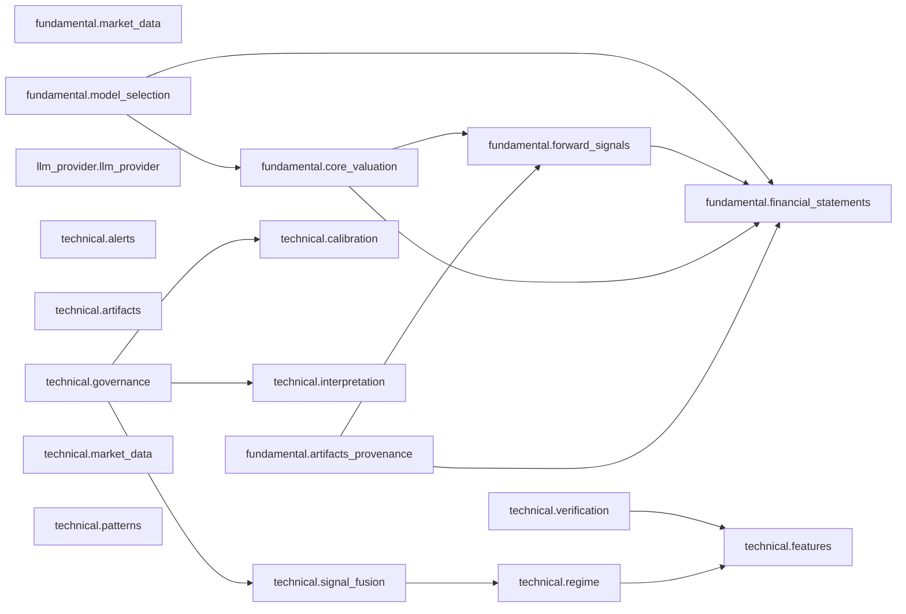

# Architecture dependency report

Generated by `python3 scripts/architecture_guard.py --write-dependency-report`.
The report scans Python imports in `finance-agent-core/src` and `finance-agent-core/api`.
It groups internal imports by their owning workflow, agent layer, capability, or shared contract.

## Scan result

- Python modules with imports scanned: 720.
- Resolved internal `src.*` imports: 4555.
- Architecture findings: 0.
- Capability packages observed: 18.
- Cross-capability dependency edges: 13.

The architecture guard found no forbidden imports, migration-only paths, or capability cycles.
All observed ownership edges satisfy the guard rules.

## Observed ownership edges

| Source owner | Target owner | Internal import count |
| --- | --- | ---: |
| `FastAPI composition` | `analysis_runtime feature` | 5 |
| `FastAPI composition` | `artifacts feature` | 1 |
| `FastAPI composition` | `audit feature` | 2 |
| `FastAPI composition` | `auth feature` | 4 |
| `FastAPI composition` | `client_debug feature` | 2 |
| `FastAPI composition` | `dashboard feature` | 4 |
| `FastAPI composition` | `infrastructure feature` | 1 |
| `FastAPI composition` | `llm_provider.llm_provider capability` | 3 |
| `FastAPI composition` | `model_inference feature` | 1 |
| `FastAPI composition` | `notifications feature` | 2 |
| `FastAPI composition` | `observability feature` | 1 |
| `FastAPI composition` | `root interface` | 1 |
| `FastAPI composition` | `search_settings feature` | 2 |
| `FastAPI composition` | `shared contracts` | 1 |
| `analysis_runtime feature` | `auth feature` | 4 |
| `analysis_runtime feature` | `debate entrypoint` | 1 |
| `analysis_runtime feature` | `fundamental entrypoint` | 1 |
| `analysis_runtime feature` | `infrastructure feature` | 11 |
| `analysis_runtime feature` | `intent entrypoint` | 1 |
| `analysis_runtime feature` | `llm_provider.llm_provider capability` | 3 |
| `analysis_runtime feature` | `model_inference feature` | 2 |
| `analysis_runtime feature` | `news entrypoint` | 1 |
| `analysis_runtime feature` | `root workflow` | 2 |
| `analysis_runtime feature` | `shared contracts` | 3 |
| `analysis_runtime feature` | `technical entrypoint` | 1 |
| `artifacts feature` | `analysis_runtime feature` | 1 |
| `artifacts feature` | `auth feature` | 3 |
| `artifacts feature` | `infrastructure feature` | 4 |
| `artifacts feature` | `shared contracts` | 23 |
| `audit feature` | `auth feature` | 14 |
| `audit feature` | `infrastructure feature` | 2 |
| `audit feature` | `shared contracts` | 5 |
| `auth feature` | `audit feature` | 22 |
| `auth feature` | `infrastructure feature` | 6 |
| `auth feature` | `notifications feature` | 3 |
| `auth feature` | `shared contracts` | 8 |
| `client_debug feature` | `auth feature` | 5 |
| `client_debug feature` | `shared contracts` | 5 |
| `dashboard feature` | `analysis_runtime feature` | 1 |
| `dashboard feature` | `auth feature` | 2 |
| `dashboard feature` | `infrastructure feature` | 1 |
| `dashboard feature` | `model_inference feature` | 1 |
| `debate application` | `artifacts feature` | 1 |
| `debate application` | `debate domain` | 14 |
| `debate application` | `debate interface` | 10 |
| `debate application` | `llm_provider.llm_provider capability` | 14 |
| `debate application` | `shared contracts` | 24 |
| `debate composition` | `artifacts feature` | 5 |
| `debate composition` | `debate application` | 3 |
| `debate composition` | `debate infrastructure` | 5 |
| `debate composition` | `debate interface` | 1 |
| `debate composition` | `llm_provider.llm_provider capability` | 2 |
| `debate composition` | `shared contracts` | 1 |
| `debate domain` | `shared contracts` | 10 |
| `debate entrypoint` | `debate application` | 1 |
| `debate entrypoint` | `debate composition` | 1 |
| `debate entrypoint` | `debate workflow` | 3 |
| `debate infrastructure` | `artifacts feature` | 10 |
| `debate infrastructure` | `debate application` | 2 |
| `debate infrastructure` | `debate interface` | 1 |
| `debate infrastructure` | `shared contracts` | 10 |
| `debate interface` | `debate domain` | 4 |
| `debate interface` | `shared contracts` | 13 |
| `debate workflow` | `artifacts feature` | 1 |
| `debate workflow` | `debate application` | 2 |
| `debate workflow` | `llm_provider.llm_provider capability` | 1 |
| `debate workflow` | `shared contracts` | 3 |
| `fundamental application` | `artifacts feature` | 14 |
| `fundamental application` | `fundamental interface` | 6 |
| `fundamental application` | `fundamental.artifacts_provenance capability` | 3 |
| `fundamental application` | `fundamental.core_valuation capability` | 8 |
| `fundamental application` | `fundamental.financial_statements capability` | 6 |
| `fundamental application` | `fundamental.forward_signals capability` | 13 |
| `fundamental application` | `fundamental.model_selection capability` | 6 |
| `fundamental application` | `shared contracts` | 28 |
| `fundamental composition` | `fundamental application` | 4 |
| `fundamental composition` | `fundamental.artifacts_provenance capability` | 1 |
| `fundamental composition` | `fundamental.financial_statements capability` | 1 |
| `fundamental composition` | `fundamental.forward_signals capability` | 5 |
| `fundamental composition` | `fundamental.market_data capability` | 1 |
| `fundamental composition` | `model_inference feature` | 1 |
| `fundamental domain` | `shared contracts` | 6 |
| `fundamental entrypoint` | `fundamental composition` | 1 |
| `fundamental entrypoint` | `fundamental workflow` | 7 |
| `fundamental interface` | `artifacts feature` | 5 |
| `fundamental interface` | `fundamental.artifacts_provenance capability` | 1 |
| `fundamental interface` | `fundamental.financial_statements capability` | 1 |
| `fundamental interface` | `fundamental.forward_signals capability` | 2 |
| `fundamental interface` | `fundamental.model_selection capability` | 2 |
| `fundamental interface` | `shared contracts` | 7 |
| `fundamental workflow` | `artifacts feature` | 1 |
| `fundamental workflow` | `shared contracts` | 3 |
| `fundamental.artifacts_provenance capability` | `artifacts feature` | 3 |
| `fundamental.artifacts_provenance capability` | `fundamental.financial_statements capability` | 3 |
| `fundamental.artifacts_provenance capability` | `fundamental.forward_signals capability` | 3 |
| `fundamental.artifacts_provenance capability` | `shared contracts` | 8 |
| `fundamental.core_valuation capability` | `fundamental domain` | 37 |
| `fundamental.core_valuation capability` | `fundamental.financial_statements capability` | 1 |
| `fundamental.core_valuation capability` | `fundamental.forward_signals capability` | 7 |
| `fundamental.core_valuation capability` | `shared contracts` | 15 |
| `fundamental.financial_statements capability` | `fundamental domain` | 29 |
| `fundamental.financial_statements capability` | `shared contracts` | 37 |
| `fundamental.forward_signals capability` | `fundamental.financial_statements capability` | 3 |
| `fundamental.forward_signals capability` | `model_inference feature` | 4 |
| `fundamental.forward_signals capability` | `shared contracts` | 24 |
| `fundamental.market_data capability` | `shared contracts` | 5 |
| `fundamental.model_selection capability` | `fundamental.core_valuation capability` | 3 |
| `fundamental.model_selection capability` | `fundamental.financial_statements capability` | 2 |
| `fundamental.model_selection capability` | `shared contracts` | 5 |
| `infrastructure feature` | `audit feature` | 1 |
| `infrastructure feature` | `auth feature` | 8 |
| `infrastructure feature` | `notifications feature` | 3 |
| `intent application` | `artifacts feature` | 3 |
| `intent application` | `intent domain` | 6 |
| `intent application` | `intent interface` | 13 |
| `intent application` | `llm_provider.llm_provider capability` | 8 |
| `intent application` | `shared contracts` | 14 |
| `intent composition` | `intent application` | 3 |
| `intent composition` | `intent infrastructure` | 3 |
| `intent composition` | `llm_provider.llm_provider capability` | 2 |
| `intent entrypoint` | `intent application` | 2 |
| `intent entrypoint` | `intent composition` | 1 |
| `intent entrypoint` | `intent workflow` | 1 |
| `intent infrastructure` | `intent application` | 3 |
| `intent infrastructure` | `intent domain` | 1 |
| `intent infrastructure` | `search feature` | 3 |
| `intent infrastructure` | `shared contracts` | 10 |
| `intent interface` | `intent domain` | 3 |
| `intent interface` | `shared contracts` | 2 |
| `intent workflow` | `artifacts feature` | 2 |
| `intent workflow` | `intent application` | 2 |
| `intent workflow` | `shared contracts` | 5 |
| `llm_provider.llm_provider capability` | `audit feature` | 2 |
| `llm_provider.llm_provider capability` | `auth feature` | 5 |
| `llm_provider.llm_provider capability` | `shared contracts` | 5 |
| `model_inference feature` | `shared contracts` | 5 |
| `news application` | `artifacts feature` | 12 |
| `news application` | `llm_provider.llm_provider capability` | 19 |
| `news application` | `model_inference feature` | 6 |
| `news application` | `news domain` | 7 |
| `news application` | `news interface` | 18 |
| `news application` | `shared contracts` | 37 |
| `news composition` | `llm_provider.llm_provider capability` | 2 |
| `news composition` | `model_inference feature` | 1 |
| `news composition` | `news application` | 5 |
| `news composition` | `news infrastructure` | 5 |
| `news composition` | `shared contracts` | 1 |
| `news entrypoint` | `news application` | 1 |
| `news entrypoint` | `news composition` | 1 |
| `news entrypoint` | `news workflow` | 3 |
| `news infrastructure` | `artifacts feature` | 7 |
| `news infrastructure` | `news application` | 2 |
| `news infrastructure` | `news domain` | 12 |
| `news infrastructure` | `news interface` | 1 |
| `news infrastructure` | `search feature` | 3 |
| `news infrastructure` | `shared contracts` | 9 |
| `news interface` | `news domain` | 1 |
| `news interface` | `shared contracts` | 17 |
| `news workflow` | `artifacts feature` | 1 |
| `news workflow` | `news application` | 2 |
| `news workflow` | `shared contracts` | 3 |
| `notifications feature` | `audit feature` | 5 |
| `notifications feature` | `auth feature` | 11 |
| `notifications feature` | `infrastructure feature` | 2 |
| `notifications feature` | `shared contracts` | 6 |
| `observability feature` | `auth feature` | 2 |
| `observability feature` | `infrastructure feature` | 4 |
| `observability feature` | `shared contracts` | 6 |
| `observability feature` | `technical.calibration capability` | 2 |
| `observability feature` | `technical.market_data capability` | 6 |
| `root services` | `infrastructure feature` | 2 |
| `root services` | `shared contracts` | 2 |
| `root workflow` | `artifacts feature` | 1 |
| `root workflow` | `shared contracts` | 3 |
| `search feature` | `shared contracts` | 3 |
| `search_settings feature` | `audit feature` | 2 |
| `search_settings feature` | `auth feature` | 5 |
| `search_settings feature` | `shared contracts` | 3 |
| `technical application` | `artifacts feature` | 8 |
| `technical application` | `shared contracts` | 115 |
| `technical application` | `technical domain` | 22 |
| `technical application` | `technical interface` | 40 |
| `technical application` | `technical.alerts capability` | 5 |
| `technical application` | `technical.calibration capability` | 3 |
| `technical application` | `technical.features capability` | 32 |
| `technical application` | `technical.interpretation capability` | 1 |
| `technical application` | `technical.market_data capability` | 7 |
| `technical application` | `technical.patterns capability` | 4 |
| `technical application` | `technical.regime capability` | 6 |
| `technical application` | `technical.signal_fusion capability` | 19 |
| `technical application` | `technical.verification capability` | 12 |
| `technical composition` | `llm_provider.llm_provider capability` | 2 |
| `technical composition` | `observability feature` | 1 |
| `technical composition` | `technical application` | 4 |
| `technical composition` | `technical.alerts capability` | 1 |
| `technical composition` | `technical.artifacts capability` | 1 |
| `technical composition` | `technical.features capability` | 3 |
| `technical composition` | `technical.interpretation capability` | 1 |
| `technical composition` | `technical.market_data capability` | 1 |
| `technical composition` | `technical.patterns capability` | 1 |
| `technical composition` | `technical.regime capability` | 1 |
| `technical composition` | `technical.signal_fusion capability` | 2 |
| `technical composition` | `technical.verification capability` | 1 |
| `technical entrypoint` | `technical composition` | 1 |
| `technical entrypoint` | `technical workflow` | 4 |
| `technical interface` | `shared contracts` | 38 |
| `technical interface` | `technical domain` | 1 |
| `technical interface` | `technical.signal_fusion capability` | 3 |
| `technical interface` | `technical.verification capability` | 5 |
| `technical workflow` | `artifacts feature` | 1 |
| `technical workflow` | `shared contracts` | 3 |
| `technical.alerts capability` | `shared contracts` | 3 |
| `technical.artifacts capability` | `artifacts feature` | 14 |
| `technical.artifacts capability` | `shared contracts` | 12 |
| `technical.artifacts capability` | `technical interface` | 2 |
| `technical.features capability` | `shared contracts` | 12 |
| `technical.features capability` | `technical domain` | 19 |
| `technical.governance capability` | `technical.calibration capability` | 2 |
| `technical.governance capability` | `technical.interpretation capability` | 1 |
| `technical.governance capability` | `technical.signal_fusion capability` | 1 |
| `technical.interpretation capability` | `llm_provider.llm_provider capability` | 6 |
| `technical.interpretation capability` | `shared contracts` | 4 |
| `technical.interpretation capability` | `technical application` | 3 |
| `technical.interpretation capability` | `technical interface` | 4 |
| `technical.market_data capability` | `shared contracts` | 4 |
| `technical.market_data capability` | `technical domain` | 2 |
| `technical.patterns capability` | `technical domain` | 9 |
| `technical.regime capability` | `technical domain` | 4 |
| `technical.regime capability` | `technical.features capability` | 5 |
| `technical.signal_fusion capability` | `technical domain` | 8 |
| `technical.signal_fusion capability` | `technical.regime capability` | 2 |
| `technical.verification capability` | `shared contracts` | 6 |
| `technical.verification capability` | `technical.features capability` | 3 |

## Capability dependency graph

Each node names a capability package. Edges show observed imports between capabilities.

| Source capability | Target capability | Import count |
| --- | --- | ---: |
| `fundamental.artifacts_provenance` | `fundamental.financial_statements` | 3 |
| `fundamental.artifacts_provenance` | `fundamental.forward_signals` | 3 |
| `fundamental.core_valuation` | `fundamental.financial_statements` | 1 |
| `fundamental.core_valuation` | `fundamental.forward_signals` | 7 |
| `fundamental.forward_signals` | `fundamental.financial_statements` | 3 |
| `fundamental.model_selection` | `fundamental.core_valuation` | 3 |
| `fundamental.model_selection` | `fundamental.financial_statements` | 2 |
| `technical.governance` | `technical.calibration` | 2 |
| `technical.governance` | `technical.interpretation` | 1 |
| `technical.governance` | `technical.signal_fusion` | 1 |
| `technical.regime` | `technical.features` | 5 |
| `technical.signal_fusion` | `technical.regime` | 2 |
| `technical.verification` | `technical.features` | 3 |
