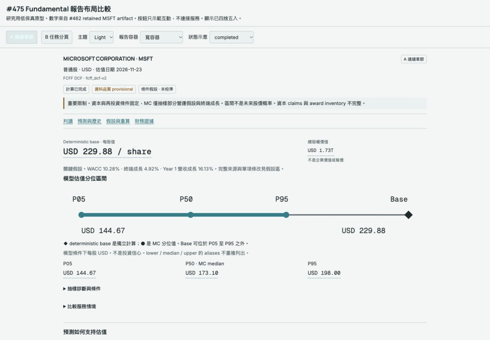
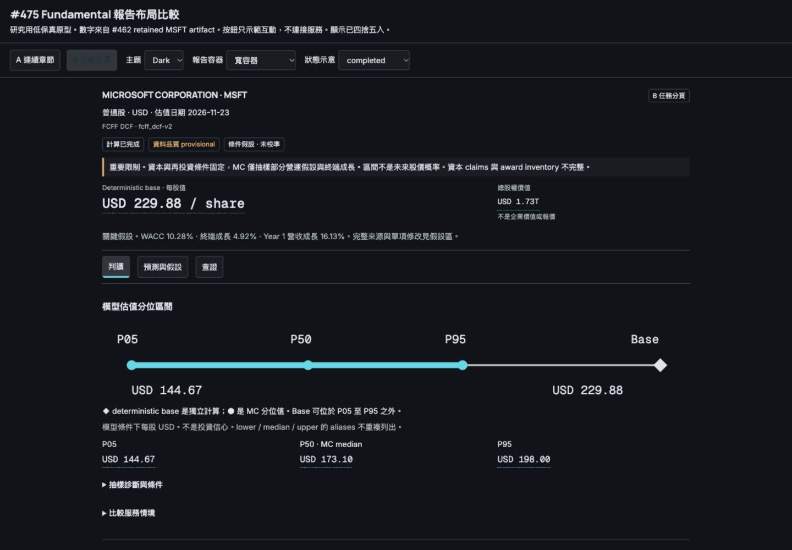

# Fundamental 報告 UI 調研與設計交接

本研究建議採用 A「連續章節」，把每股估值、模型區間、關鍵假設及影響解讀的限制放在前面，再以章節定位與來源面板支持深入查證。B「任務分頁」保留作比較方案，適合反覆查表，但跨任務時較易丟失上下文。這是專家走查所得的設計建議，沒有招募 trader 或分析師，不能稱為使用者研究。

日期為 2026-11-23，香港。Source commit 為 `cf091fb3b3518ef20c616947ce390bf069bfe031`，已於研究開始 fetch 並核對 `origin/main`。原 Desktop checkout 位於落後版本但無 WIP；研究使用獨立 worktree，沒有 reset 或改動原 checkout。範圍對應 [#475](https://github.com/sosodennis/value-investment-agent/issues/475)。正式 UI、估值公式、後端契約、資料獲取與上線均未實作。

## 交付導覽

| 文件 | 用途 |
| --- | --- |
| [現況與資料流](current-state.md) | artifact、parser、view model、報告與 inspector 的責任、固定 commit 來源連結 |
| [數字與單位](number-format.md) | 欄位語義、before/after、精度、copy、極值與缺失規則 |
| [原型 HTML](prototype.html) | A/B 切換、窄容器、明暗、來源與狀態示意，下載後以本目錄的 HTTP server 開啟 |
| [走查與合規](walkthrough.md) | 同任務比較、瀏覽器矩陣、截圖、通過項目及未驗證界線 |
| [實作交接](handoff.md) | 元件責任、資料映射、狀態、驗收案例及新增依賴 |
| [真實資料摘錄](sample.json) | 原始 Decimal、來源身分、五年預測、選用歷史 facts、抽樣與限制 |
| [決策紀錄](decisions.tsv) | 設計取捨、修正與證據指標，不另設 task tracker |
| [獨立審閱](review.md) | 未主導方案者的發現、處理及結案判斷 |

GitHub 不直接執行 HTML。可直接閱讀本文件與截圖；需要操作時下載此目錄，執行 `python3 -m http.server 8475 --directory docs/research/issue-475`，開啟 `http://127.0.0.1:8475/prototype.html`。無需正式應用、Compose、帳戶或估值服務。`python3 docs/research/issue-475/build-prototype.py` 從 sample、template 與原專案 semantic tokens 重建原型。原型使用原生 HTML 控件，只作布局和互動示意；產品實作繼續用 source-owned primitives。

## 方法與可核對證據

先完整讀取 #475 最新正文與附錄、適用 AGENTS、frontend UI/engineering guidelines、globals.css、primitives、lockfile 及 Discussion #130 的採納決定。依 pstack investigation，`how` 的兩個唯讀探索者分別追蹤資料流與 retained artifact/互動，另由 explainer 整合並重讀關鍵 source。`sharpen` 把問題限定為讀者的七項任務，而非增加功能清單。Prototype 階段使用兩個布局比較，方向已由 canonical Professional Matte 確定，沒有另行發明色盤。`prove-it-works` 要求讀回實際 DOM、canonical 原文及可見畫面；technical-writing 與 unslop 用於文件整理。

直接讀取 #462 保留的 post-merge MSFT artifact，沒有重跑完整估值。原始檔 SHA-256 為 `192c54598fc4cd88fc79c8dfc3a6ac8870aa9ccdd28eb35793a7ada26798549c`。run `bacbf333-83c7-450b-bc23-4e0e06dcf224`、artifact `505feae3-faf5-4f68-a4ca-e05c136884d5` 與 [公開驗收](https://github.com/sosodennis/value-investment-agent/issues/462#issuecomment-7094882155) 一致。[已合併 acceptance](https://github.com/sosodennis/value-investment-agent/blob/cf091fb3b3518ef20c616947ce390bf069bfe031/docs/acceptance/issue-462-acceptance.md#L50) 保留 base、equity、quantiles、revision 與拒絕證據。`sample.json` 是必要研究欄位摘錄，沒有冒充完整 wire artifact。

本研究可證明這份 retained 結果的表示能力，不能證明數據已涵蓋所有公司、所有模型、所有期間，或已按市場結果校準。App CI、Docker health 與正式服務重驗不適用本次純研究；原型瀏覽器驗證另行記錄，不能承接 #462 的產品測試作為本設計已實作的證明。

## 四個原始問題的核對

| 問題 | 核對結果 | 設計選擇及理由 |
| --- | --- | --- |
| Decimal 過長 | `report-value.tsx:6` 直接 raw 並 break-all；summary 同用 ExactValue | 主閱讀採語義格式，原文留在可點擊的來源層。縮短掃讀，同時保留查證 |
| 百分比缺失 | 主假設、歷史 ratios 直接 raw；修改表單已有 exact ratio/percent 轉換 | 以 path/node semantics 決定百分比，不以值域猜測。沿用 canonical 字串 |
| 全部展開 | 全假設與 84 facts 同頁；sources、historical metrics、diagnostics 其實已收起 | 保留既有 disclosure，進一步把完整假設、facts、metadata 移到查證層。重要品質警告持續可見 |
| 圖表不足 | 已有 quantile marker；年度預測存在 nodes，尚無專用主圖/表 | 改善現有區間圖去重，新增真實五年圖表投影。缺資料的圖不畫 |

現況詳細路徑與行號在 [current-state.md](current-state.md)。本研究沒有把「已有但不好讀」寫成「完全沒有」。

## 讀者與首屏

Trader 的第一個任務是判斷這份結果是否值得繼續讀。首屏回答公司、股份、幣別、日期、base 每股值、MC median/範圍、關鍵假設，以及甚麼限制可能改變解讀。沒有正式綁定的報價呈現契約時，畫面不添加現價、upside 或買賣建議。

分析師需要知道數字如何產生、哪裡不完整，以及如何修改和查證。第二層提供五年預測、可比歷史、假設方法與單項重算；第三層提供完整 facts、計算節點、Decimal、公式、來源文件與技術身分。每個主要值可直接開選中內容，完整 inventory 不再排在選中內容之前。

| 資訊 | 預設位置 | 閱讀任務與取捨 |
| --- | --- | --- |
| 公司、ticker、股別、USD、估值日期 | 首屏，長股別可展開完整原文 | 避免讀錯股份/日期；完整法定名稱不佔主數值空間 |
| Deterministic base 每股值 | 主值，24px 上限，具名查證按鈕 | 找估值；避免把股權總值或 P50 當主值 |
| P05/P50/P95 與條件 | 主值附近；mobile 用文字序列替代小型圖 | 理解模型範圍；base 獨立 marker，保留非概率說明 |
| lower/median/upper | 同 basis 的 alias 留在查證對照 | 去除三組重複值；不能按相同數字合併不同 quantile |
| WACC、terminal growth、Year 1 growth | 摘要短列；完整假設在下方 | 判斷結果依賴；摘要並非代表只有這三項影響結果 |
| provisional、uncalibrated、資本資料不完整 | 持續可見的文字限制 | 直接影響判讀，不收在 metadata 或只用色彩 |
| 五年預測與可比歷史 | 第二層，分開標籤，章節定位 | 看模型機制；不把預測接成已觀測歷史 |
| 完整假設、來源方法、capital inputs | 按需展開 | 減少同時掃讀量；保留原始/已套用/manual reason |
| 服務情境 | 獨立 disclosure，使用服務順序定位 | 與 MC 分位值分開；少一組預設並排值，換取身分準確 |
| 84 facts、20 fields | 精選財務值加「完整證據」入口 | 主畫面不鋪 84 rows；完整表仍須可檢索，不只保留精選 |
| model version、digests、hashes、seed | 詳細查證，預設收起 | 工程核對仍可取得；不讓技術字串主導閱讀 |
| invalid/convergence failure | 影響品質時提升為可見警告 | 成功診斷可收，失敗不能藏 |

## 圖表與資料條件矩陣

以下「現有可做」指這份資料具備表示條件，未指產品 UI 已實作。每圖以同一 run/artifact/preparation 與適用 scope 綁定；缺值保留缺口，文字替代與來源按鈕不能省略。

| 候選 | 回答甚麼 | 欄位、單位與期間 | 資料分類 | 缺失、表格取捨與追溯 |
| --- | --- | --- | --- | --- |
| 估值分位區間 | 模型條件下分位範圍與 base 差多遠 | root p05/p50/p95；獨立 base per_share_value；USD/share，同一 basis | 現有可做 | 不連 Gaussian；缺任一 quantile 只列已有值並說明。表格列 exact quantile labels，點值到 root uncertainty；base 到 base node |
| 五年營收、FCFF | 服務預測如何變化 | base revenue_1..5、fcff_1..5、discounted_fcff_1..5；USD B；Year 1..5 | 本樣本現有可做，其他模型先驗 nodes | 營收與 FCFF 分圖，不用雙軸。表格更適合 exact 年度比較，含折現 FCFF；缺 node 留 gap，不重算。點值查 node/formula |
| 歷史營收趨勢 | 相同口徑的實際營收如何變化 | 四筆 annual revenue facts FY2023..2026，USD，dimensions=[]，consolidated | 此組可做；其他歷史 series 需核對完整性 | 歷史表保留精確期間、facts、filing。缺年不接線；混 duration/instant、幣別、dimensions 或覆蓋時停用趨勢，回列表。原型使用表格，趨勢圖為可選後續 |
| 歷史 margin/tax/NOPAT | 服務歷史 ratios 是否支持營運假設 | historical_metrics 的 metric_id/value/unit/fiscal_year/fact_ids | 需核對完整性及比較口徑 | margin/tax 用 %、NOPAT 用 USD B，不能混軸。未涵蓋年份不補。禁止前端自行拿不配對 facts 計算 ratio |
| 服務情境比較 | 不同服務輸入結果差多少 | scenario_results per_share_value、quality、input_digest、nodes | 現有可做，命名須額外核對 | 以「服務情境 1/2/3」定位，保留原順序及 digest。不可按大小推 Bear/Bull，也不給概率。表格比三張卡省空間，點值查該 scenario scope |
| EV 至 equity 橋接 | 哪些條件資本調整影響股權值 | 同一 base enterprise/equity nodes 與 cash、non_operating_assets、debt、preferred_stock、leases、NCI | 需核對完整性、符號、scope 及服務節點 | 樣本七項在，但 complete_capital_claims=false、complete_award_inventory=false。先用「條件假設」節點表。無同 scope 完整組成時不畫瀑布、不補差額，更不能稱實際完整資本結構 |
| 本次與上一份 | 修改後哪個結果改變 | 兩份 retained artifact；原/新 terminal growth；服務結果與日期 | 兩份都保留時可做 | Pending 只保留 previous；失敗沒有新值。表格並列與 source identity 比圖更能防誤讀，不計算新估值 |
| Histogram/density | 每次抽樣分布形狀 | individual MC draws | 需新增服務資料 | 本樣本沒有 draws。三個 quantiles 不可合成 histogram、Gaussian 或平滑密度 |
| Tornado/熱圖 | 哪個 input 影響結果、WACC×g 曲面 | sensitivity coordinates、單位、driver definitions、服務結果 | 需新增服務資料 | 本樣本 sensitivity={}、dominant_drivers=[]。即使數值列表非空，沒有 coordinates 仍不夠熱圖 |
| 現價/upside | 估值與何時何股別的價格比較 | 正式 typed quote identity/source/time/class/currency 與比較結果 | 需新增/提升報告呈現契約 | retained upstream conditional_quote 其實有 2026-11-20 Yahoo daily close，但目前 report VM 未投影正式 quote。不能稱資料全無，也不能當即時現價或自行補 upside |
| 同業、完整歷史三表 | 與 peers 或完整財報比較 | 尚未承諾的覆蓋、口徑及來源 | 需新增服務資料 | 84 facts/20 fields 不等於完整 statements，列後續依賴即可 |

## 兩個布局與推薦理由

A 採連續章節與錨點導覽。讀者看過主值及限制後，向下閱讀或跳到預測、假設與查證。桌面 inspector 顯選中內容，小屏使用 Sheet。上下文可保留，但長報告仍有垂直距離，因此完整 facts 與技術資料按需開啟。

B 保留結果 strip 與限制，將內容分為「判讀」「預測與假設」「查證」。每頁較短，反覆查 facts 時容易維持單一任務；代價是前後比較要切 tab，尤其在窄容器看預測後想再查 P50 時，需要回到判讀頁。Tab 不能隱藏品質與 previous result。

推薦 A 的理由是本報告的核心任務跨結果、假設、預測及來源。連續章節讓讀者在同一閱讀脈絡中查證，且沿用目前 report 的 section ownership。這是專家判斷，沒有以虛構速度、成功率或信心分數支持它。B 仍可供後續以真實分析師任務進行使用測試。詳見 [同條件走查](walkthrough.md)。

原型截圖只證明研究版面的可見結果。

## 外部參考與採用範圍

下列來源均於 2026-11-23 讀取，HTTP 200。它們支持呈現決策，不證明金融模型有效。

| 來源 | 支持的決策 |
| --- | --- |
| [ONS rounding](https://service-manual.ons.gov.uk/content/numbers/rounding) | 按用途選精度、保留資料 detail；微小重要值不能因 rounding 消失 |
| [ONS money](https://service-manual.ons.gov.uk/content/numbers/money) | 同序列小數位一致；表格可統一量級。本專案 ISO/M/B/T 是研究採用，非 ONS 原文規定 |
| [ONS percentages](https://service-manual.ons.gov.uk/content/numbers/percentages) | 同序列百分比格式一致；百分點與相對百分比變動分開 |
| [ONS line chart](https://service-manual.ons.gov.uk/data-visualisation/chart-types/line-chart) | 時序用途、缺失保留斷點，不以假連線暗示連續資料 |
| [ONS bar charts](https://service-manual.ons.gov.uk/data-visualisation/chart-types/bar-charts) | 比較值的條形/柱形軸由零起，避免視覺誇大 |
| [WCAG 2.2](https://www.w3.org/TR/WCAG22/) | 1.1.1 文字替代；1.4.1 非純色；1.4.3 對比；1.4.4 200% resize；1.4.10 reflow；2.1.1 鍵盤；2.4.7/2.4.11 focus；2.5.8 target；3.3.1/3.3.2 labels/errors；4.1.3 status |
| [WAI complex images](https://www.w3.org/WAI/tutorials/images/complex/) | 圖旁短說明及結構化文字/表格替代，不只 hover |
| [ARIA modal dialog](https://www.w3.org/WAI/ARIA/apg/patterns/dialog-modal/) | 開啟焦點、Tab containment、Escape 與關閉後 focus return |
| [ARIA tabs](https://www.w3.org/WAI/ARIA/apg/patterns/tabs/) | B 的 role/labels、左右鍵、Home/End、單一 tab stop |

Discussion #130 的 [採納決定](https://github.com/sosodennis/value-investment-agent/discussions/130#discussioncomment-19148652) 支持 source-owned shadcn、semantic tokens、數字可查證與明確重算。其現價差距、完整三表、近似分布及任意 what-if 是方向，必須再經本報告資料契約核對，不能視為已實作能力。
