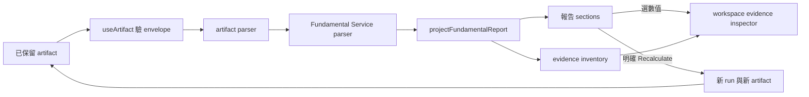

# Fundamental 報告資料流與現有能力

核對日期為 2026-11-23，香港時間。Source commit 為 `cf091fb3b3518ef20c616947ce390bf069bfe031`。本說明整合兩個唯讀探索角度，並重新核對 parser、projection、報告組版、區間圖及 revision availability 的相關程式。沒有啟動正式應用，沒有重新抓取 SEC 或報價，也沒有重跑估值服務。

## 概覽

Fundamental 報告已具備 canonical Decimal、財務 facts、假設證據、deterministic base、MC 分位值、服務情境及單項重算的資料路徑。核心問題在於閱讀層尚未依金融語義縮短數字、分配資訊優先序，已有的年度計算節點也未成為專門的預測圖表。現況並非完全沒有圖表或 disclosure。區間 marker 圖已存在，來源、歷史 metrics 及 sampling diagnostics 已預設收起。

目前資料流保留服務的計算與證據身分。前端負責解析、投影、呈現和提交使用者意圖，沒有必要為 UI 重算估值。研究建議應在這條既有邊界上增加 typed 格式語義、可比 series 投影與查證入口，不能把短顯示字串當作 canonical 值或 source identity。

## 關鍵概念

| 概念 | 現況及用途 |
| --- | --- |
| Canonical Decimal | `exactNumber` 保存 `raw` 字串，另產生有限的 Number 座標供圖形定位。座標不能取代原文精度。見 `fundamental-report-model.ts:149`。 |
| Deterministic base | `service_result.base` 的確定性結果。`intrinsic_value` 映射為股權總值，`per_share_value` 為每股值。企業價值另見同一 base 的 node。見 model `:200`。 |
| Root uncertainty | MC quantiles、sample diagnostics 和 scenario_results 有自己的 input/result binding。不能與 base hash 混用。見 model `:305`。 |
| Fact | 財務證據各有期間、單位、dimensions、quality 及來源。值也可能是 boolean 或缺失 variant，不能把所有 strings 當數字。見 `fundamental-service-facts.ts:272`。 |
| Assumption evidence | path、值、方法、來源及 editable 由服務提供。原始、已套用 manual、manual application unconfirmed 已分開投影。見 model `:224`。 |
| Evidence identity | thread、run、artifact、preparation 及適用的 node/result scope 共同綁定所選證據。不能只用 ticker 或顯示名稱。見 model `:127`、`:162`。 |
| Report variant | valuation、facts-only、preparation-outcome、service-error 是不同結果。沒有估值不一定表示失敗。見 model `:289`。 |

## 資料如何到達畫面

`useArtifact` 將網路 JSON 當作 unknown，先驗 envelope，再調用 payload parser。`parseFundamentalArtifact` 調用 `parseFundamentalServiceArtifact`，後者核對 projection type、fact ID、snapshot、digest、hash 與 base 綁定。這層已擁有資料接受與拒絕規則。UI 不應為格式化再建立不綁來源的 payload fallback。入口在 `frontend/src/hooks/useArtifact.ts:100`、`frontend/src/types/agents/artifact-parsers.ts:3459` 及 `frontend/src/types/agents/fundamental-service-facts.ts:599`。

`projectFundamentalReport` 從 identity 取得公司、股別、security 與幣別。facts 依 period_end 倒序排列，再按 fact_id 排序，這個順序沒有保證多筆 facts 已構成可比時間序列。`factModel` 保留原文、期間、unit、scale、dimensions 和品質，但只把 normalized_field 轉成人讀 label，未保留獨立 normalized field key。後續 formatter 需要穩定語義 key，不能從 label 猜百分比。見 model `:172`、`:281`。

`calculationModel` 把 base 的結果、節點、公式、inputs 和 source binding 投影給畫面。年度 revenue、FCFF 和 discounted FCFF 已是服務節點，前端可映射成預測 series，毋須重算。`preparationSummary` 則投影假設與服務計算的歷史 ratios，並依 exact applied input 判斷 manual 值是否已套用。這個判斷不可改成比較四捨五入後的文字。見 model `:200`、`:224`、`:262`。

報告依序呈現 summary、uncertainty、全假設、全 facts，再接 Sources/method。Sources、historical metrics、sampling diagnostics 已用預設關閉的 details。主要 `ExactValue` 與 `InspectionValue` 直接輸出 raw，並以 break-all 避免溢位，因此長值仍會在數字中間斷行。修改表單已具備精確 ratio 與 percent 字串轉換，不能說整個前端完全沒有百分比能力。見 `fundamental-analysis-output.tsx:233`、`report-value.tsx:6`、`valuation-revision.ts:92`。

uncertainty projection 以 Object.entries 保留所有 quantile keys，畫面也全量輸出。本次 artifact 的 lower、median、upper 分別是 p05、p50、p95 的重複 aliases。可在同一 basis 和契約語義成立時只顯示 P05、P50、P95，查證保留 alias 對照。不能因任意兩個 quantiles 值相等便合併它們。現有 marker 圖已用圓點區分 quantiles、菱形區分 deterministic base，且其軸包含 base。見 model `:309`、`valuation-uncertainty.tsx:7`、`:112`。

Evidence inventory 已集合 facts、assumptions、base nodes、quantiles 及 scenario nodes。選中數值後，workspace 核對 source identity 再設定 selection。窄畫面開 Sheet，關閉時返回原 active element；寬桌面使用右側 inspector。現況 inspector 先列全部 inventory，再在其後放 selected detail。84 facts 加其他證據會讓當前要查的內容落在長清單後。摘要的 base 每股值與股權總值本身目前尚非 evidence button，來源查證須從詳細 node 進入；專用複製 raw 及 filing 外連按鈕也是後續 UI 能力。見 `workspace-page.tsx:86`、`:98`、`workspace-evidence-inspector.tsx:122`、`:139`、`valuation-summary.tsx:6`。

### 本次真實樣本支持甚麼

直接讀取 #462 保留的 post-merge manual-base artifact，其 SHA-256 為 `192c54598fc4cd88fc79c8dfc3a6ac8870aa9ccdd28eb35793a7ada26798549c`。run `bacbf333-83c7-450b-bc23-4e0e06dcf224`、artifact `505feae3-faf5-4f68-a4ca-e05c136884d5` 與 [#462 公開驗收](https://github.com/sosodennis/value-investment-agent/issues/462#issuecomment-7094882155) 一致。交付用 extract 保留必要欄位與原字串；它不是完整 wire artifact，也不是重新取得的金融資料。

| 項目 | 核對結果 |
| --- | --- |
| 身分 | MICROSOFT CORPORATION、MSFT、USD、Common stock。估值 timestamp 是 `2026-11-23T05:51:07.263703Z`，artifact created_at 是 `2026-11-23T07:41:05+00:00`，兩者須分開標示。 |
| 核心結果 | Base 每股 `229.88242539685962775556419207139754074672901162460`；股權總值 `1731474428089.1467162549094946817662769043629155565`。公開 canonical 值見 acceptance `:50`。 |
| 分位值 | P05 `144.665049…`、P50 `173.100589…`、P95 `197.999837…`。Base 高於 P95，不能強制放在區間內，也不能以 base 取代 median。完整原文在 extract 與公開 acceptance。 |
| 五年預測 | 五組 revenue、FCFF、discounted_fcff nodes 完整。Year 1 至 Year 5 是 ordinal horizon，沒有已核對的公曆年映射。 |
| 歷史 | 84 facts、20 normalized fields。四年營收 FY2023 至 FY2026 為相同 annual duration、USD、consolidated issuer、dimensions=[]，可作這組營收趨勢。其他欄位的期間覆蓋不同。 |
| MC | 256 requested、256 valid、0 invalid。沒有 individual draws；sensitivity={}、dominant_drivers=[]。不能畫 histogram、Gaussian、tornado 或熱圖。 |
| 品質 | calculation completed，但 quality provisional，條件假設未校準。區間不是未來股價概率或投資信心。 |

四年營收的 canonical USD 值依序為 `211915000000`、`245122000000`、`281724000000`、`331839000000`。這組 duration 均為七月至翌年六月，source scale=6。Canonical 已是 USD，不能再乘 `10^6`。有這四筆資料不等於有完整多期三大報表。

### 修改如何變成新結果

`valuationRevisionAvailability` 只對 prepared、未 revision、唯一且 editable 的 terminal_growth，且 source identity 完整的原始自動報告開放一次修改。歷史與已修改報告唯讀。可用性不能由「欄位看來像數字」推斷。見 `valuation-revision.ts:38` 和 `workspace-page.tsx:94`。

修改百分比與必填理由先成為 draft，明確按 Recalculate 才送新 run。Pending 期間原 artifact 保留為 Previous result；只有新 artifact 確認後才更新結果。來源綁定與 operation token 另負責拒絕不屬於當前來源或已過時的回應。見 `valuation-revision-panel.tsx:104`、`valuation-revision-state.ts:61`、`:85`、`fundamental-analysis-output.tsx:94`。

#462 已實證 2.5% 轉成 canonical `0.025` 後產生新每股值 `168.92316962973986376214271505310878928165576150584`。原始 `0.0492` 與已套用 manual `0.025` 各有證據。5% 修改則回傳 `MANUAL_OVERRIDE_INVALID`，服務要求 manual override ≤ `0.04`，沒有 service_result、execution 或成功 hashes。這個 manual 約束不表示原自動假設 4.92% 不合法。前端應呈現 owning service 的拒絕，不重寫其 policy，也不把拒絕當成估值零。見公開 acceptance `:52`、`:54` 與 #462 comment。

Research 是 opt-in，請求本身不改 draft。符合 accepted claim、公司與 model/preparation 綁定、授權與引用等條件才有 Apply，Apply 後仍需明確重算。#462 的 live provider 僅取得 unavailable/error，沒有成功的 live licensed Research→Apply 證據。介面必須容納沒有可 Apply 結果。不能由 panel 支援 ready 分支便聲稱 provider 目前可用。

## 檔案位置

下列連結固定到核對 commit，行號不是 main 浮動版。

| 位置 | 責任 |
| --- | --- |
| [useArtifact.ts:100](https://github.com/sosodennis/value-investment-agent/blob/cf091fb3b3518ef20c616947ce390bf069bfe031/frontend/src/hooks/useArtifact.ts#L100) | envelope 與 payload 接收邊界。 |
| [fundamental-service-facts.ts:599](https://github.com/sosodennis/value-investment-agent/blob/cf091fb3b3518ef20c616947ce390bf069bfe031/frontend/src/types/agents/fundamental-service-facts.ts#L599) | Service artifact runtime parser。 |
| [fundamental-report-model.ts:149](https://github.com/sosodennis/value-investment-agent/blob/cf091fb3b3518ef20c616947ce390bf069bfe031/frontend/src/features/workspace/outputs/fundamental-analysis/fundamental-report-model.ts#L149) | raw、coordinate、facts、計算、假設及 uncertainty 投影。 |
| [fundamental-analysis-output.tsx:151](https://github.com/sosodennis/value-investment-agent/blob/cf091fb3b3518ef20c616947ce390bf069bfe031/frontend/src/features/workspace/outputs/fundamental-analysis/fundamental-analysis-output.tsx#L151) | 報告 variant、section 組版與 Previous result。 |
| [report-value.tsx:6](https://github.com/sosodennis/value-investment-agent/blob/cf091fb3b3518ef20c616947ce390bf069bfe031/frontend/src/features/workspace/outputs/fundamental-analysis/report-value.tsx#L6) | 原文數字與查證按鈕呈現。 |
| [valuation-uncertainty.tsx:7](https://github.com/sosodennis/value-investment-agent/blob/cf091fb3b3518ef20c616947ce390bf069bfe031/frontend/src/features/workspace/outputs/fundamental-analysis/valuation-uncertainty.tsx#L7) | Marker 圖、分位值、情境與診斷。 |
| [valuation-revision.ts:38](https://github.com/sosodennis/value-investment-agent/blob/cf091fb3b3518ef20c616947ce390bf069bfe031/frontend/src/features/workspace/outputs/fundamental-analysis/valuation-revision.ts#L38) | 單次 terminal growth revision 可用性與精確百分比轉換。 |
| [workspace-evidence-inspector.tsx:93](https://github.com/sosodennis/value-investment-agent/blob/cf091fb3b3518ef20c616947ce390bf069bfe031/frontend/src/features/workspace/workspace-evidence-inspector.tsx#L93) | 證據 inventory 與 selected detail。 |
| [workspace-page.tsx:190](https://github.com/sosodennis/value-investment-agent/blob/cf091fb3b3518ef20c616947ce390bf069bfe031/frontend/src/features/workspace/workspace-page.tsx#L190) | 三欄與窄畫面 Sheet、focus return、history。 |
| [issue-462-acceptance.md:41](https://github.com/sosodennis/value-investment-agent/blob/cf091fb3b3518ef20c616947ce390bf069bfe031/docs/acceptance/issue-462-acceptance.md#L41) | 公開保留的真實 acceptance、canonical 值及限制。 |

## 容易誤讀的界線

1. 上游並非沒有 quote。Retained `automatic_preparation.conditional_quote` 有 USD `484.5199890136719`、MSFT、issuer、Yahoo daily-close URI/hash 及 `as_of=2026-11-20T05:00:00Z`。但 parser 僅以 optional JSON dictionary 接受，report view model 未投影正式 quote 欄位。正確分類是「上游已保留，尚無報告呈現契約」，不能稱即時現價或自行新增 upside。見 parser `:171`、`:175`，以及 model `:224`。
2. `scenario_results` 沒有直接 name/scenario_id。上游 conditional hypothesis 雖有 base/downside/upside 名稱，不能依順序或每股值高低替換三組報告的身分。保留「服務情境 1/2/3」是目前可支援的顯示；命名需 exact input mapping 或服務明確提供 identity。
3. Base capital_bridge 七個輸入俱在，卻不代表觀測到完整資本結構。Policy 明示 `complete_capital_claims=false`、`complete_award_inventory=false`，部分值是條件假設。橋接若展示，必須註明「條件假設下的 base」，保留未知資料，使用服務結果與公式，不由前端補數。
4. 抽樣的 `quantile_contract` 含 bear→p05、base→p50、bull→p95。這裡的 label 不是 deterministic base，也不賦予三組服務情境概率或 Bear/Bull 身分。MC 的 hypothesis probabilities 為 not_assigned。
5. Inspector 的 generic `Confidence` 欄實際可能接 fact quality 或 assumption method。新顯示應用「資料品質」及「假設方法」，不能稱投資信心水準。見 model `:187`、`:258` 和 inspector `:165`。
6. 1440px viewport 不等於 1440px 報告容器。1440px 起三欄預設 18/58/24，中央另有 padding，最小可縮至 34%。1439px 以下 report 與 evidence Sheet 的布局也不同。須測 report container reflow，不能只測全頁寬度。上述比例是 source inspection，並非本 pass 的瀏覽器實測值。
7. 本 pass 證明的是 source 與 retained data 能力。它未證明正式 UI 已通過 320/390/768/1440px、200% zoom、鍵盤、focus、螢幕閱讀器或 reduced motion 驗收，也未擴大其他公司或模型的支援範圍。
