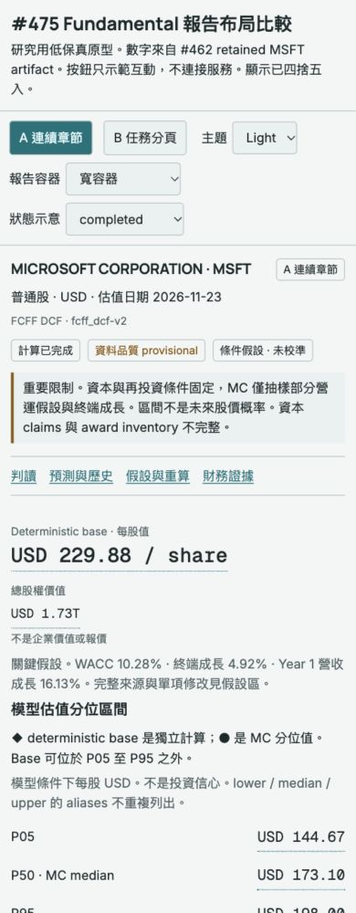
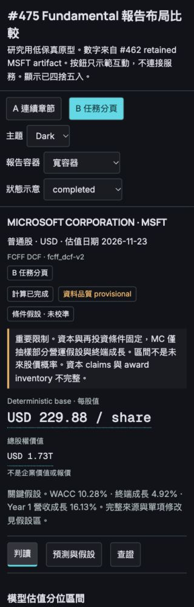
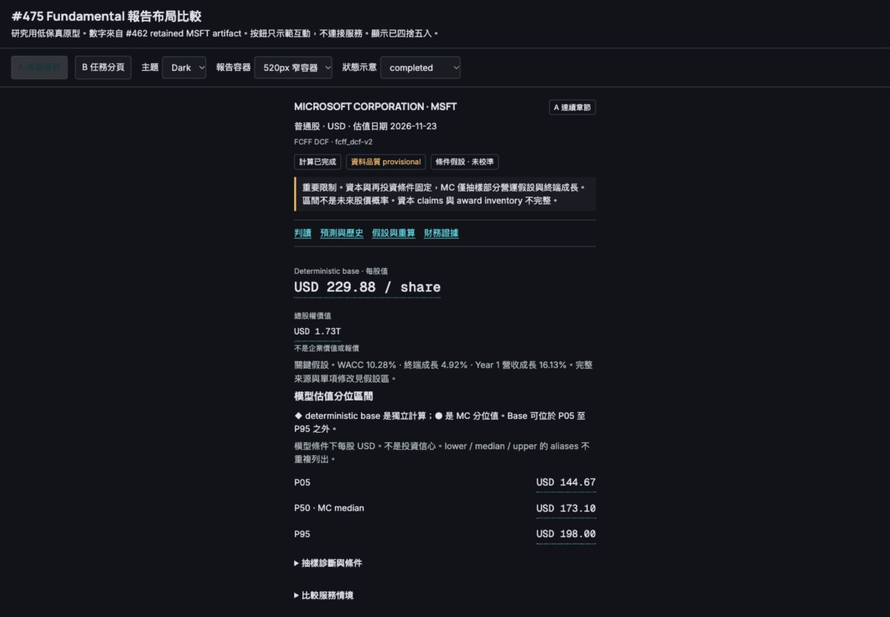
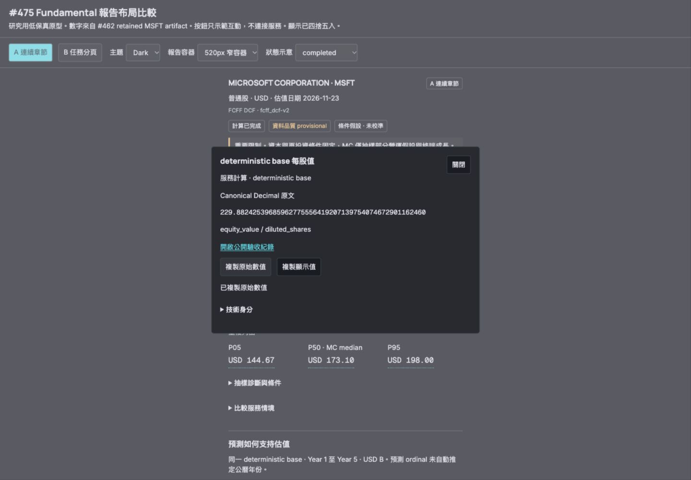
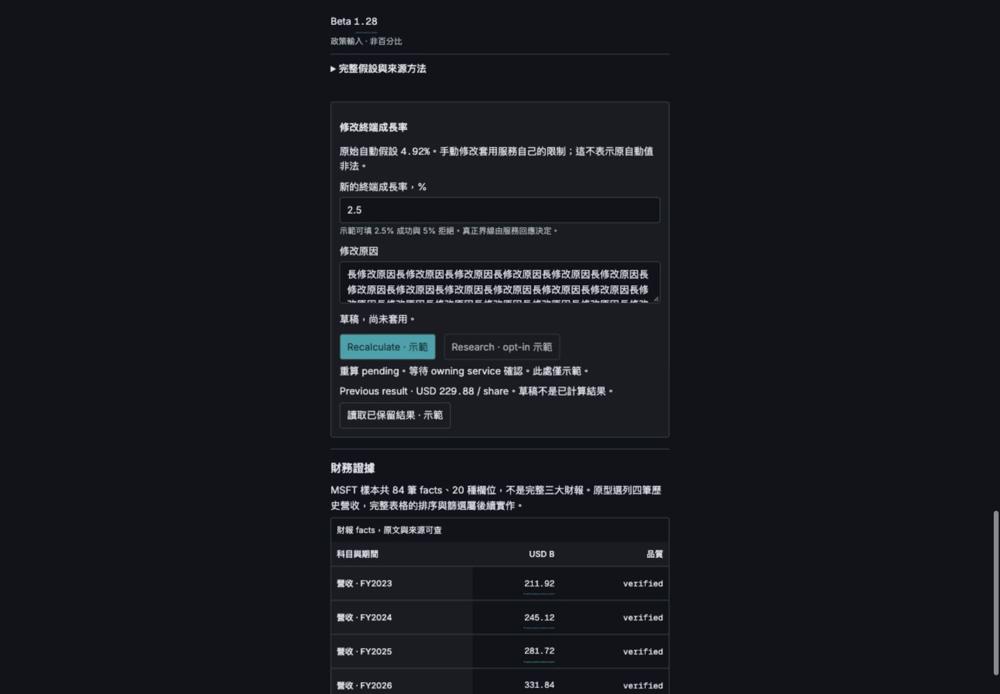

# 布局走查、瀏覽器觀察與 UI 標準核對

日期為 2026-11-23，香港。此紀錄評估研究原型，沒有招募使用者，沒有重新啟動正式 Next.js/FastAPI 應用。真實服務成功/拒絕案例沿用 #462 retained artifacts，原型按鈕不送網路 mutation。不能把本紀錄稱為產品已通過無障礙、瀏覽器或端到端驗收。

## 相同任務比較

方法為作者專家走查。兩案共用 sample、格式、限制、來源按鈕與 revision 示意，A/B 只改資訊組織。從初始判讀頁開始，每個 click 或鍵盤 activation 算一次；輸入字元、捲動距離、等待時間及原型外的 workspace navigation 不混入數字。操作數是設計路徑計數，不是效能、速度或實際使用成功率。每條路徑走一次，沒有統計區間，不能推導節省幾秒或提升幾成。

| 任務 | A 路徑與操作 | B 路徑與操作 | 上下文與判斷 |
| --- | --- | --- | --- |
| 找每股估值 | 初始可見，0 | 初始 result strip 可見，0 | 同樣明標 deterministic base、USD/share |
| 分辨 base 與 median | 同區閱讀，0 | 初始判讀 tab，0 | Base229.88 與 P50 173.10 分開。若從預測頁讀回 median，A 不切tab；B需回判讀1次 |
| 理解關鍵假設/限制 | 摘要與警告0；完整假設錨點1 | 摘要與警告0；完整假設tab1 | A保留連續脈絡，B切換後少了分位內容；限制兩案均不隱藏 |
| 看歷史與預測 | 預測錨點1；兩者分開呈現 | 預測與假設tab1 | 同樣用真實服務nodes和四年facts；A還能向上對照range，B需切回 |
| 追查主值來源並返回 | 開來源1、關閉1 | 開來源1、關閉1 | 選中raw先顯，不必掃84筆inventory；keyboard return已觀察 |
| 修改/重算/理解拒絕 | 假設錨點1、submit1、原型讀保留結果1 | 預測tab1、submit1、原型讀保留結果1 | 最後一個activation只屬原型模擬，不是production多一步；真正結果由backend確認 |
| 讀回歷史 | selector切history1，只驗唯讀呈現 | selector切history1，只驗唯讀呈現 | 沒有真workspace歷史導覽的本次browser證據；工程驗收須從history入口讀原artifact |

兩案的單次進入步數多數相同，推薦 A 並非宣稱點擊更少。A 在跨結果、預測、假設、證據的閱讀任務中保留位置，B 在單一tab內較短但有額外內容切換。A 的成本是垂直距離，需靠摘要、錨點與完整facts disclosure控制。原型只列四筆代表facts，不能用其頁面高度估計完整84筆展開後的滾動距離。

## 瀏覽器測試條件與結果

使用 CUA 控制 Codex IAB，localhost `127.0.0.1:8475`，viewport height1000px。寬容器原型最大1100px，另測1440px viewport下獨立520px report。這是研究容器，不是假稱正式三欄pane實際量測寬度。正式source在1440px起預設18/58/24，且有padding，需在產品驗收另量。

讀回 DOM 的 innerWidth、documentElement.scrollWidth、report bounding box、可見短值、字體載入與圖表替代狀態，並保存截圖。原始紀錄見 [browser-observations.json](browser-observations.json)。

| 寬度 | A light/dark | B light/dark | 實際觀察 |
| --- | --- | --- | --- |
| 320 | 已查 | 已查 | pageWidth320、report320，無整頁水平溢出；小區間SVG隱藏，改讀標籤和值 |
| 390 | 已查 | 已查 | pageWidth390、report390；主值可讀，序列/內容往下排 |
| 768 | 已查 | 已查 | pageWidth768、report768，區間marker可見，數值表仍可查 |
| 1440 | 已查 | 已查 | pageWidth1440、report1100，base文字USD229.88/share；沒有把viewport當pane寬 |
| 1440內520容器 | A dark已查 | 版面規則共用，未另拍B窄容器 | report520、forecast單欄488px；range改文字替代，不把SVG標籤縮至難讀 |

兩案×兩主題×四viewport共16個矩陣點。這個數字只計上表明列的條件，沒有把520容器或先前失敗的初測加算成通過數。Manrope實際heading為70016px，已確認此weight載入；初次以未使用的400weight查詢得到false，沒有當成字體未載或通過證據。Inter與Geist Mono亦讀回loaded。

初稿在mobile把600px viewBox縮成很小的文字，且520容器仍使用兩欄。可見截圖促成修正，最終改用container query，600px以下堆疊並以可讀分位值取代小圖。此修正是原型研究結果，非正式source變更。

### 數值與互動

| 檢查 | 觀察 | 結論及界線 |
| --- | --- | --- |
| Base原文 | inspector完整字串與sample逐字相等 | 研究原型通過 |
| P50、WACC、Year1 revenue、FY2026 revenue | 四組inspector raw逐字等於sample | 研究原型通過；不是全部84facts或所有node的全覆蓋 |
| 鍵盤開啟/關閉 | Enter開主值、Escape關閉、activeElement回原數值aria-label | 原型已觀察；正式Sheet仍須同樣驗收 |
| B左右鍵 | ArrowRight使forecast tab aria-selected=true | 原型已觀察；完整screen reader宣告尚未驗證 |
| Modal焦點 | 從標題按Tab進來源連結；但從close按Shift+Tab後DOM焦點不在dialog內 | 不宣稱focus containment通過。後續Radix Sheet/Dialog必驗正反向完整cycle |
| Copy原文 | UI顯示已複製，navigator API未報錯；IAB session clipboard讀回空字串 | 端到端copy未驗證。不能只靠success文案宣稱逐字貼上通過；正式驗收需真paste與拒絕fallback |
| 長文字 | 修改理由輸入300個中文字；textarea462px位於520容器，pageWidth1440不溢出 | 此textarea已觀察；任意超長公司名、翻譯與所有來源URL仍列產品驗收 |
| Pending | previous229.88保留、submit disabled、draft未冒充結果 | 原型已觀察 |
| 2.5%成功 | 讀retained新base168.92；原始4.92%與manual2.50%文字並列 | 是保留結果示意，原型上方仍為原artifact；正式版須整份切換新source與quantiles |
| 5%拒絕 | MANUAL_OVERRIDE_INVALID、manual上限0.04、無新值、舊結果保留 | 原型已觀察；拒絕真實服務證據來自#462，不是本次重送 |
| Research | opt-in後顯示configured provider unavailable，沒有Apply | 原型已觀察；沒有live licensed成功的本次證據 |
| History | 唯讀說明、revision form不可見 | 只驗狀態呈現，不冒稱重做history API驗收 |
| facts-only等 | selector逐一觀察10狀態；無估值狀態主值不顯 | 模擬狀態，不是10個真實service responses；完整skeleton/retry等尚未實作 |
| 200%browser zoom | 三次super+plus後innerWidth仍1440、devicePixelRatio1，未確認zoom改變 | 未驗證。沒有用viewport減半、CSS縮放或圖片代稱browser200% |
| reduced motion | 原型無動效，template包含prefers-reduced-motion規則 | source檢查；未切作業系統偏好，也未驗正式app動畫 |

## Canonical UI guideline 對照

核對 [frontend UI guide](https://github.com/sosodennis/value-investment-agent/blob/cf091fb3b3518ef20c616947ce390bf069bfe031/docs/frontend-ui-guideline.md) 與 [frontend engineering guide](https://github.com/sosodennis/value-investment-agent/blob/cf091fb3b3518ef20c616947ce390bf069bfe031/docs/frontend-guideline.md)。「符合設計」不同於「正式產品通過」。

| 標準 | 本案決策與證據 | 尚需實作驗證 |
| --- | --- | --- |
| Professional Matte、compact | unframed sections、20px原型標題、24px主值、節制border與4pxradius | 正式shell與report的整體密度 |
| Semantic tokens/light-dark | generator直接抽globals.css的root/dark；不設featurepalette，16點明暗矩陣 | 正式primitives、chart tooltip、disabled/focus各狀態對比 |
| Manrope/Inter/Geist Mono | heading/body/數字角色與DOMloaded檢查 | 正式Next font載入、offline fallback；原型Google Fonts需網路 |
| Tabular numerals | mono值與table font-variant-numeric | 真實字級、長貨幣及多語label |
| Source-owned primitives/Lucide | 正式交接對應現有Button/Field/Table/Tabs/Sheet，沒有新增UIkit | 原型用native HTML，不能宣稱已使用或已驗Radix行為 |
| Recharts相容 | lockfile2.15.4，使用可由既有SVG/一般圖實現的marker與bar設計 | 真正Recharts2 renderer與顯式tick尺寸，無升級前提 |
| 顏色非唯一訊號 | quality/status文字、◆/●圖例、period labels、表格替代 | 真實screen reader與色覺使用測試 |
| Calculation/quality/assumption分離 | completed、provisional、conditional各有文字 | 全部typed variants與connection state實際事件 |
| 初始/partial/error/stale/reconnect | 狀態矩陣與selector示意 | 正式skeleton、safe retry、局部失敗、replay/hydration |
| Responsive/narrow |16點viewport與520container；小圖改文字 | 真workspace三欄、320 touch、200%zoom、長公司名 |
| Focus/labels/keyboard | 有具名數值button、label、focus ring、Escape/return、B箭頭 | Modal反向containment未通過；全keyboard與screen reader待驗 |
| Reduced motion | prototype無animation，提供media override | 正式展開、loading、stream動畫與OS設定 |
| 圖表替代 | caption、同資料表格、raw來源；缺資料不畫 | 真實圖表tooltip鍵盤/觸控及ARIA讀法 |
| Parser-first/ownership | 只建scratch研究工具，production source未改 | 工程實作依handoff，在typed model處格式化，不補財務公式 |

本研究保留以上未驗證項目，沒有為了完成表格而宣稱全部a11y通過。後續驗收案例F18至F20要求真實產品補驗。研究的結案條件是資料可信、方案與取捨可讀、限制如實、交接可執行並經獨立審閱。
